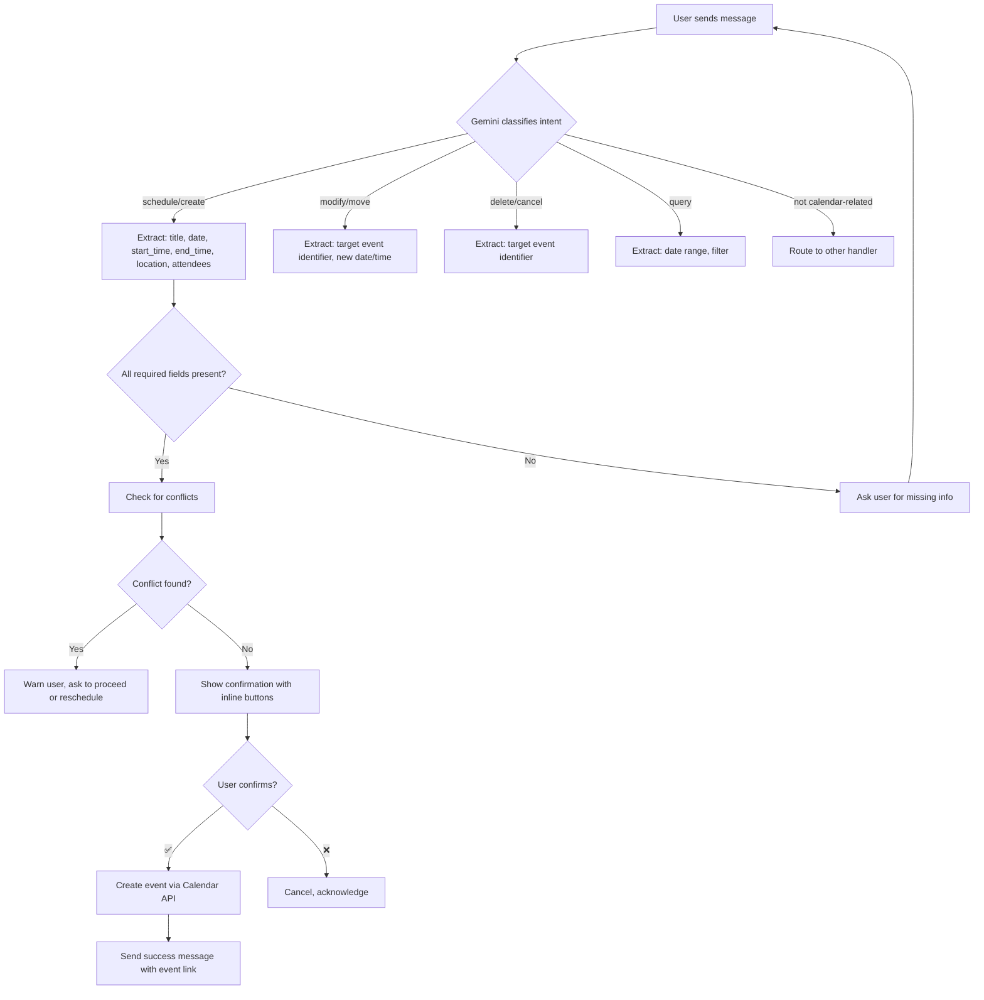
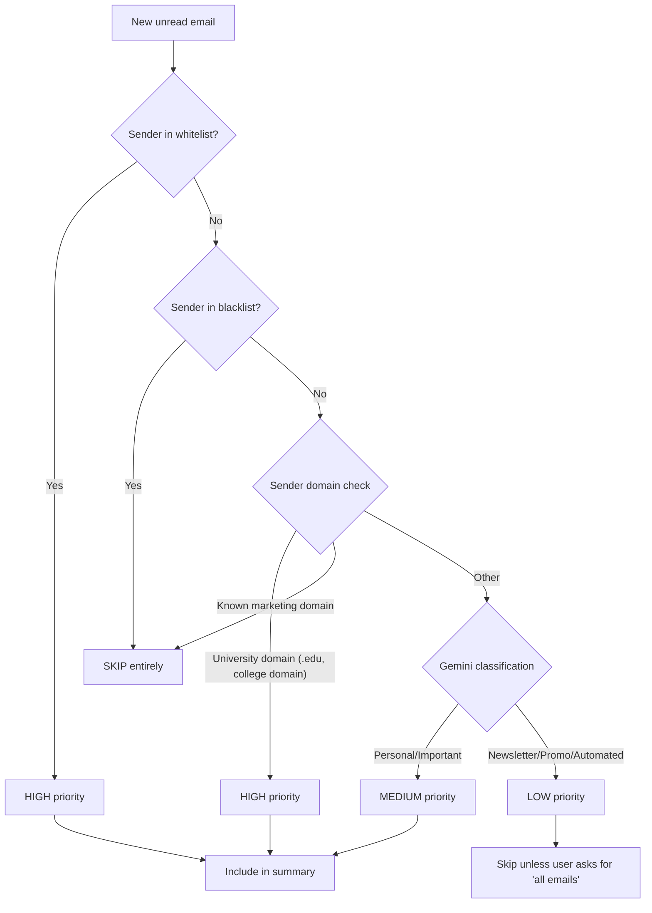
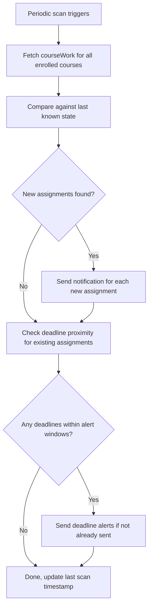
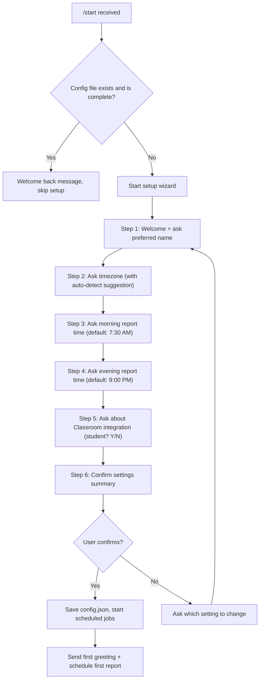
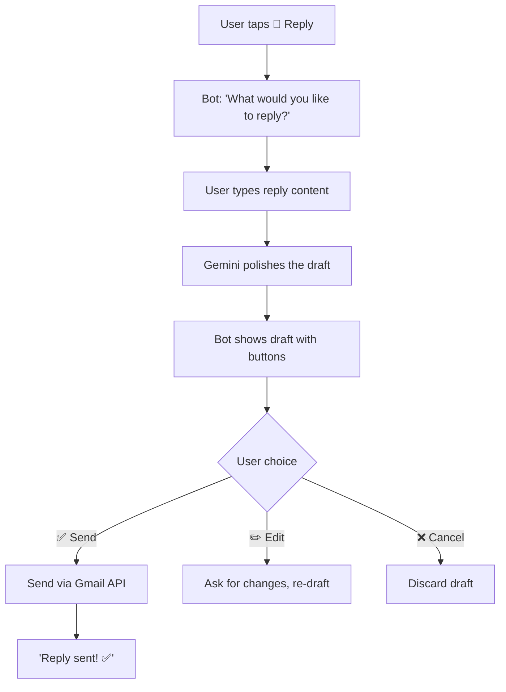
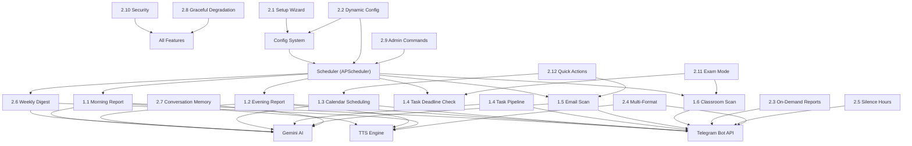

# Features Specification — Autonomous AI Personal Assistant

> **Document Purpose:** Single source of truth for every feature in the system. For each feature, this document defines what the user experiences, what the system does technically, how edge cases are handled, priority level, and dependencies. A developer reading this should be able to implement any feature end-to-end without ambiguity.

> [!IMPORTANT]
> **Priority Levels Used Throughout This Document:**
> | Level | Meaning | Implication |
> |-------|---------|-------------|
> | **P0** | MVP / Must-Have | System cannot launch without this. Required for first deploy. |
> | **P1** | Important | Should ship within the first iteration after MVP. High user value. |
> | **P2** | Nice-to-Have | Enhances experience but system is fully functional without it. |

---

## Table of Contents

- [Section 1: Core Features](#section-1-core-features)
  - [1.1 Morning Voice Briefing](#11-morning-voice-briefing-730-am)
  - [1.2 Evening Voice Briefing](#12-evening-voice-briefing-900-pm)
  - [1.3 Natural Language Calendar Scheduling](#13-natural-language-calendar-scheduling)
  - [1.4 Task & Reminder Pipeline](#14-task--reminder-pipeline)
  - [1.5 Gmail Smart Summarization](#15-gmail-smart-summarization)
  - [1.6 Classroom Assignment Scraper](#16-classroom-assignment-scraper)
- [Section 2: Additional Features](#section-2-additional-features)
  - [2.1 First-Run Setup Wizard](#21-first-run-setup-wizard-via-telegram)
  - [2.2 Dynamic Configuration via Chat](#22-dynamic-configuration-via-chat)
  - [2.3 On-Demand Reports](#23-on-demand-reports)
  - [2.4 Multi-Format Responses](#24-multi-format-responses)
  - [2.5 Smart Silence Hours](#25-smart-silence-hours)
  - [2.6 Weekly Digest](#26-weekly-digest)
  - [2.7 Conversation Memory](#27-conversation-memory-lightweight)
  - [2.8 Graceful Degradation](#28-graceful-degradation)
  - [2.9 Admin Commands](#29-admin-commands)
  - [2.10 Security Features](#210-security-features)
  - [2.11 Exam/Assignment Mode](#211-examassignment-mode)
  - [2.12 Quick Actions via Inline Buttons](#212-quick-actions-via-inline-buttons)
- [Feature Dependency Map](#feature-dependency-map)

---

## Section 1: Core Features

---

### 1.1 Morning Voice Briefing (7:30 AM)

| Attribute | Value |
|-----------|-------|
| **Priority** | P0 |
| **Trigger** | APScheduler cron job at user-configured time (default 07:30 in user's timezone) |
| **Output** | Telegram voice note (OGG/Opus) + optional text fallback |
| **Duration Target** | 60–180 seconds (1–3 minutes) |
| **Dependencies** | Google Calendar API, Google Tasks API, Gmail API, Google Classroom API, Gemini AI, TTS engine, Telegram Bot API |

#### User Experience

Every morning at 7:30 AM (or the user's configured time), the user receives a Telegram voice note. It sounds like a personal radio-style briefing — warm, upbeat, concise. The tone is that of a smart friend who already checked everything for you. No robotic lists. The briefing follows a natural spoken flow.

If the voice note fails to generate, the user receives the same content as a formatted text message instead. The user never wakes up to silence.

#### Data Sources & Extraction

The system pulls data from all integrated sources in parallel before composing the script. Each source has a defined extraction scope:

| Source | What Is Extracted | API Call |
|--------|-------------------|----------|
| **Google Calendar** | All events for today, from midnight to 11:59 PM in user's timezone. Fields: event title, start time, end time, location (if any), attendees (count + names if ≤3). | `events.list` with `timeMin`/`timeMax` set to today's bounds |
| **Google Tasks** | All incomplete tasks across all task lists. Fields: task title, due date (if set), notes snippet (first 100 chars). Filter to: tasks due today, overdue tasks, tasks due tomorrow (as a heads-up). | `tasks.list` for each task list, filtered by `dueMax` = end of tomorrow |
| **Gmail** | Unread emails received since the last morning report (or last 12 hours if first run). Apply smart filtering (see §1.5). Fields: sender name, subject line, 1-line AI-generated summary, action-needed flag. Cap at 7 most important emails. | `messages.list` with `q=is:unread after:{timestamp}`, then `messages.get` for each |
| **Google Classroom** | Assignments due today or tomorrow across all enrolled courses. Fields: course name, assignment title, due date/time, submission status. Also: any new assignments posted since last check. | `courses.courseWork.list` + `studentSubmissions.list` |
| **Weather** *(optional, P2)* | Current conditions and today's high/low if a weather API key is configured. | OpenWeatherMap or similar free API |

#### AI Script Generation

The raw data is assembled into a structured prompt sent to Gemini. The prompt instructs Gemini to produce a spoken script with these constraints:

- **Tone:** Friendly, personal, upbeat morning energy. Use the user's preferred name. Conversational — not a bullet list read aloud.
- **Structure:** Greeting → Calendar overview → Task reminders → Email highlights → Classroom deadlines → Closing motivation.
- **Length:** Target 150–350 words (maps to ~1–3 minutes of speech at ~130 WPM for TTS).
- **Rules:**
  - If the calendar is empty, say so positively ("Your schedule is wide open today — nice!").
  - If there are overdue tasks, mention them with gentle urgency, not guilt.
  - Group related items ("You've got two classes back to back this afternoon...").
  - End with a brief motivational or contextual closing line.

**System prompt template (sent to Gemini):**

```
You are a personal assistant generating a morning voice briefing for {user_name}.
Today is {date_formatted} ({day_of_week}).
Timezone: {timezone}.

Speak directly to the user in second person. Be warm, concise, and natural —
like a smart friend giving a quick morning rundown. Do NOT use bullet points,
markdown, or any formatting — this text will be spoken aloud as a voice note.

Here is today's data:

CALENDAR:
{calendar_json}

TASKS:
{tasks_json}

EMAILS:
{email_summaries_json}

CLASSROOM:
{classroom_json}

Generate a spoken briefing. Target: 150-350 words. Start with a greeting using
their name, end with a brief motivational sign-off. If any data section is empty,
acknowledge it briefly and move on. If a data source was unavailable, mention
"I couldn't check your [source] this morning, but here's everything else."
```

#### Example Morning Report Transcript

> *"Good morning, Aditya! It's Wednesday, November 4th — let's get you set up for the day.*
>
> *So, your calendar's looking pretty structured today. You've got Data Structures at 10 AM, then a gap until your study session with Arjun from 4 to 6 PM — that's the one you set up on Monday. No location set for that, so you might want to sort out where you're meeting.*
>
> *On the task front, you've got two things on your radar. That lab file submission is due by Friday midnight — so you've still got a couple of days, but maybe worth chipping away at it today. And you've got 'buy groceries' sitting on your to-do list, no due date on that one.*
>
> *Email-wise, three things came in overnight. Professor Mehta sent a message about the mid-semester feedback form — looks like you need to fill that out by this week. There's a reply from the library about your book hold, it's ready for pickup. And the college fest committee sent an update about registrations, nothing you need to act on.*
>
> *For Classroom — no new assignments since yesterday, but a quick reminder that your Operating Systems lab report is due tomorrow by 5 PM. It's still showing as not submitted, so keep that on your radar.*
>
> *Alright, that's the rundown. You've got a solid day ahead — knock it out! Talk to you tonight."*

#### Voice Note Generation

1. The Gemini-generated script is passed to the TTS engine (Google Cloud Text-to-Speech, `gTTS`, or `edge-tts`).
2. TTS output is saved as a temporary `.mp3` or `.ogg` file in a temp directory.
3. The file is sent to Telegram via `send_voice` (for OGG/Opus) or `send_audio` (for MP3).
4. After successful send confirmation from Telegram API, the temp file is deleted.
5. The timestamp of this report is saved to the state file for reference by the next report cycle.

#### Edge Cases

| Edge Case | Behavior |
|-----------|----------|
| **One data source fails** (e.g., Gmail API 503) | Generate the report with available data. Include a line in the script: "I couldn't check your emails this morning, but here's everything else." Log the failure with full traceback. |
| **All data sources fail** | Send a text message: "Hey {name}, I tried to put together your morning briefing but couldn't reach any of your Google services right now. I'll try again in 30 minutes." Schedule a one-shot retry in 30 minutes. Max 2 retries. |
| **Gemini API is down** | Fall back to template-based report (see §2.8 Graceful Degradation). Use hardcoded string templates with data interpolation. |
| **TTS engine fails** | Send the script as a formatted text message instead of a voice note. Prepend: "🔇 *Couldn't generate voice today — here's your briefing in text:*" |
| **No events / no tasks / no emails** | The AI script should handle each empty section naturally. An entirely empty day should produce a short, cheerful "all clear" briefing (~30 seconds). |
| **User changed timezone recently** | The cron job fires based on the latest timezone in config. If timezone changed mid-day, next scheduled report uses the new timezone. Current day's report that already fired is not re-sent. |
| **Report time falls during Silence Hours** | This should not happen because report time is user-configured and Silence Hours are also user-configured. If they conflict, the system warns the user during configuration and does not apply Silence Hours to scheduled reports (reports are exempt from silencing). |
| **Duplicate report** | The system checks if a morning report was already sent today (by checking the last report timestamp in the state file). If a report was already sent for today's date, the cron job skips. This prevents duplicates on server restarts. |

---

### 1.2 Evening Voice Briefing (9:00 PM)

| Attribute | Value |
|-----------|-------|
| **Priority** | P0 |
| **Trigger** | APScheduler cron job at user-configured time (default 21:00 in user's timezone) |
| **Output** | Telegram voice note (OGG/Opus) + optional text fallback |
| **Duration Target** | 60–150 seconds (1–2.5 minutes) |
| **Dependencies** | Google Calendar API, Google Tasks API, Google Classroom API, Gemini AI, TTS engine, Telegram Bot API |

#### User Experience

In the evening, the user receives a wind-down briefing. The tone shifts — it's calmer, reflective, and forward-looking. The report reviews what happened today and previews what's coming. It feels like a debrief from a thoughtful assistant, not a task manager barking orders.

#### Data Sources & Extraction

| Source | What Is Extracted | Logic |
|--------|-------------------|-------|
| **Google Calendar (review)** | All events that were scheduled for today. For each event, determine status by comparing event end time to current time: events with `end_time < now` are "completed/past", events with `end_time > now` are "still happening" or "upcoming tonight". | `events.list` with today's time bounds |
| **Google Calendar (preview)** | All events for tomorrow. If today is Friday, also pull Saturday and Sunday. If today is Sunday, pull all of next week's events as a "week ahead" preview. | `events.list` with `timeMin`/`timeMax` for preview window |
| **Google Tasks (review)** | Tasks that were completed today (check `completed` timestamp). Tasks that are overdue as of now. Tasks due tomorrow. | `tasks.list` with status filters |
| **Google Classroom** | Assignments due tomorrow or within the next 3 days. Submission status for each. Any new assignments posted today that weren't in the morning report. | `courses.courseWork.list` filtered by due date window |
| **Gmail** | Not included in evening report by default (to keep it concise and wind-down focused). Can be enabled in config. | N/A unless enabled |

#### "Review What Was Cleared" — Technical Definition

The system compares the day's calendar events against the current time:

```
for each event in today_events:
    if event.end_time <= now:
        status = "done"          # Event has passed
    elif event.start_time <= now < event.end_time:
        status = "in_progress"   # Event is happening right now
    else:
        status = "upcoming"      # Event is still ahead tonight

for each task in today_tasks:
    if task.status == "completed" and task.completed_date == today:
        status = "cleared"
    elif task.due_date <= today and task.status != "completed":
        status = "missed/overdue"
```

The AI script uses these statuses to construct a natural review: *"You had three things on your calendar today — your morning lecture, the Arjun study session, and the library book pickup. Looks like those are all done. Nice."*

#### Tone & Script Guidelines

- **Tone:** Calm, reassuring, slightly reflective. Like a "how'd the day go?" check-in.
- **Structure:** Greeting → Day review → Completed tasks acknowledgment → Tomorrow preview → Upcoming deadlines alert → Closing wind-down.
- **Length:** Target 120–300 words (~1–2.5 minutes).
- **Rules:**
  - Acknowledge accomplishments: "You checked off 3 tasks today — solid work."
  - Be gentle about missed items: "That grocery run is still on the list — no rush, maybe tomorrow?"
  - Preview tomorrow with just enough detail to set expectations, not cause anxiety.
  - Closing should be relaxing: "Get some rest, you've earned it."

#### Example Evening Report Transcript

> *"Hey Aditya, winding down for the day — let's do a quick recap.*
>
> *You had a pretty full Wednesday. Data Structures this morning, then your study session with Arjun ran from 4 to 6 — hope that went well. Everything on the calendar is cleared.*
>
> *On tasks, you knocked out that grocery run today, nice. The lab file submission is still pending — that's due Friday midnight, so you've got tomorrow to wrap it up.*
>
> *Looking ahead to tomorrow — Thursday's got your Operating Systems lecture at 9 AM and a tutorial session at 2 PM. And that OS lab report? It's due tomorrow by 5 PM, and it's still showing as not submitted on Classroom. That's probably your top priority for tomorrow.*
>
> *Nothing else major coming up this week beyond that. Friday's pretty light — just the lab submission deadline at midnight.*
>
> *Alright, that's everything. Get some rest tonight, and I'll catch you in the morning. Good night!"*

#### Edge Cases

| Edge Case | Behavior |
|-----------|----------|
| **Calendar was empty today** | Script says: "Your calendar was clear today — hopefully you made good use of the free time." |
| **No tasks were completed** | Skip the "accomplishments" section. Don't draw attention to it negatively. Just move to tomorrow's preview. |
| **Tomorrow has no events** | "Tomorrow's looking open — no scheduled events. Might be a good day to tackle that [overdue task]." |
| **It's Friday evening** | Preview window extends through the weekend: "This weekend looks quiet" or "You've got [event] on Saturday." |
| **It's Sunday evening** | Include a "week ahead" mini-preview: "Starting the week on Monday, you've got..." covering Monday–Wednesday at minimum. |
| **Morning report wasn't sent** (e.g., server was down) | Evening report does NOT try to compensate. It sticks to its own format. The morning report gap is logged but not mentioned to the user unless specifically configured to. |
| **Same failure/retry logic as morning** | Identical to §1.1: partial data → partial report, all fail → retry, Gemini down → template, TTS down → text. |

---

### 1.3 Natural Language Calendar Scheduling

| Attribute | Value |
|-----------|-------|
| **Priority** | P0 |
| **Trigger** | User sends a Telegram message containing a scheduling intent |
| **Output** | Confirmation message with event details + inline buttons |
| **Dependencies** | Gemini AI (for NLP parsing), Google Calendar API, Telegram Bot API, Conversation Memory (§2.7) |

#### User Experience

The user sends a natural-language message to the Telegram bot. The system parses the intent, extracts event details, checks for conflicts, and asks for confirmation before creating the event. The user never needs to know API syntax, date formats, or calendar IDs.

#### Intent Detection & Parsing Flow



#### Gemini Parsing Prompt

The user's message is sent to Gemini with a structured extraction prompt:

```
You are a calendar scheduling assistant. Parse the user's message and extract
event details as JSON. Today's date is {today}. The user's timezone is {timezone}.

Rules:
- "tomorrow" = {tomorrow_date}
- "this Wednesday" = {this_wednesday_date}
- "next week" = week starting {next_monday_date}
- If no end time is given, default duration is 1 hour.
- If no year is given, assume the nearest future occurrence.
- Return ONLY valid JSON matching this schema:

{
  "intent": "create" | "modify" | "delete" | "query",
  "title": "string",
  "date": "YYYY-MM-DD",
  "start_time": "HH:MM" (24-hour),
  "end_time": "HH:MM" (24-hour),
  "location": "string or null",
  "attendees": ["email1", "email2"] or [],
  "original_event_query": "string identifying the existing event (for modify/delete)",
  "confidence": 0.0-1.0
}

User message: "{message}"
```

#### Example Commands & System Behavior

| User Message | Parsed Output | System Action |
|-------------|---------------|---------------|
| "Book a study session with Arjun this Wednesday from 4 to 6 PM" | `{intent: "create", title: "Study session with Arjun", date: "2026-11-04", start_time: "16:00", end_time: "18:00"}` | Check for conflicts at that time → Show confirmation → Create event |
| "Schedule a dentist appointment tomorrow at 3" | `{intent: "create", title: "Dentist appointment", date: "2026-11-03", start_time: "15:00", end_time: "16:00"}` | No end time given → default 1 hour. Confirm → Create. |
| "Move my meeting with Prof. Sharma to Friday" | `{intent: "modify", original_event_query: "meeting with Prof. Sharma", date: "2026-11-06"}` | Search calendar for matching event → Confirm change → Update event |
| "Cancel the dentist appointment" | `{intent: "delete", original_event_query: "dentist appointment"}` | Search calendar → Confirm deletion → Delete event |
| "What do I have on Thursday?" | `{intent: "query", date: "2026-11-05"}` | Fetch events for that date → Return formatted text list |

#### Confirmation Message Format

When the system is ready to create an event, it sends:

```
📅 Here's what I'll add to your calendar:

  Title:  Study session with Arjun
  Date:   Wednesday, Nov 4, 2026
  Time:   4:00 PM – 6:00 PM
  Calendar: Primary

[ ✅ Create ] [ ✏️ Edit ] [ ❌ Cancel ]
```

The inline buttons are Telegram `InlineKeyboardMarkup` buttons with callback data:

| Button | Callback Data | Action |
|--------|--------------|--------|
| ✅ Create | `cal_confirm_{uuid}` | Create the event, send success message |
| ✏️ Edit | `cal_edit_{uuid}` | Ask "What would you like to change?" and wait for follow-up |
| ❌ Cancel | `cal_cancel_{uuid}` | Delete the pending event from temp storage, acknowledge |

The `{uuid}` is a unique ID for this pending event, stored in an in-memory dict with a 10-minute TTL. If the user doesn't respond within 10 minutes, the pending event is discarded and the buttons are deactivated (edited to show "⏰ Expired").

#### Conflict Detection

Before showing the confirmation, the system queries the calendar for events overlapping the proposed time range:

```python
# Pseudocode
existing = calendar_service.events().list(
    calendarId='primary',
    timeMin=proposed_start_rfc3339,
    timeMax=proposed_end_rfc3339,
    singleEvents=True
).execute().get('items', [])

if existing:
    # Filter out all-day events (they don't conflict with timed events)
    timed_conflicts = [e for e in existing if 'dateTime' in e.get('start', {})]
```

If conflicts exist, the confirmation message changes:

```
⚠️ Heads up — you already have something at that time:

  📌 "Data Structures Lecture" from 4:00 PM – 5:00 PM

Still want to create "Study session with Arjun" from 4:00 – 6:00 PM?

[ ✅ Create Anyway ] [ 🔄 Pick Another Time ] [ ❌ Cancel ]
```

#### Timezone Handling

- All user-facing times are displayed in the user's configured timezone (stored in `config.json`).
- All API calls use RFC 3339 timestamps with the timezone offset (e.g., `2026-11-04T16:00:00+05:30`).
- The Gemini parsing prompt includes the user's timezone and today's date to resolve relative references correctly.
- If the user sends a message like "at 3 PM EST" with an explicit timezone, the system should honor it and convert appropriately for the calendar entry while displaying both timezones in the confirmation.

#### Event Modification (Move/Reschedule)

When the intent is `modify`:

1. The system searches the calendar for events matching `original_event_query` within a ±7 day window from today.
2. Search uses fuzzy string matching on event titles (Gemini can also extract keywords to match against).
3. If exactly one match → proceed with modification confirmation.
4. If multiple matches → present a numbered list and ask user to pick.
5. If no matches → respond: "I couldn't find an event matching '[query]' in your calendar. Could you be more specific?"

#### Edge Cases

| Edge Case | Behavior |
|-----------|----------|
| **Ambiguous date** ("next Friday" when today is Friday) | Gemini should interpret "next Friday" as the Friday of the following week, not today. If confidence < 0.7, ask user to confirm the date. |
| **Missing time** ("Schedule a meeting with Rohan on Monday") | Ask: "What time works for the meeting with Rohan on Monday?" |
| **Past date/time** ("Schedule a meeting yesterday at 3") | Respond: "That time has already passed. Did you mean [next occurrence]?" |
| **Very long event** (> 8 hours) | No block — create it, but confirm: "That's a {X}-hour event — just confirming that's right?" |
| **Attendees without email** ("with Arjun") | Add the name to the event title instead of the attendee list. Note: "I added Arjun's name to the event title since I don't have their email." |
| **Gemini parse failure** | Respond: "I wasn't quite sure what you meant. Could you rephrase? For example: 'Schedule [event name] on [date] from [start time] to [end time]'." |
| **Calendar API quota exceeded** | Respond: "I'm having trouble reaching your calendar right now. I'll try again in a few minutes." Queue a retry. |

---

### 1.4 Task & Reminder Pipeline

| Attribute | Value |
|-----------|-------|
| **Priority** | P0 |
| **Trigger** | User message (create/manage), APScheduler background loop (reminders) |
| **Output** | Telegram text messages and notification pings |
| **Dependencies** | Google Tasks API, Gemini AI (for NLP), APScheduler, Telegram Bot API |

#### User Experience

The user can create tasks, set reminders, and manage their to-do list through natural conversation. Reminders fire as Telegram messages at the appropriate time. The system feels like texting a personal assistant who never forgets anything.

#### Intent Detection

User messages related to tasks/reminders are classified by Gemini into:

| Intent | Example | Parsed Fields |
|--------|---------|---------------|
| `create_task` | "Add buying groceries to my to-do list" | `{title: "Buy groceries", due_date: null, task_list: "default"}` |
| `create_reminder` | "Remind me to submit lab files by Friday midnight" | `{title: "Submit lab files", remind_at: "2026-11-06T23:55:00", due_date: "2026-11-07T00:00:00"}` |
| `list_tasks` | "What's on my to-do list?" | `{filter: "all"}` or `{filter: "today"}` |
| `complete_task` | "Mark groceries as done" | `{query: "groceries", action: "complete"}` |
| `delete_task` | "Remove the groceries task" | `{query: "groceries", action: "delete"}` |
| `snooze_reminder` | "Snooze that for 30 minutes" | `{query: "last_reminder", snooze_duration: 30}` |

#### Task Creation Flow

1. Parse user message with Gemini to extract task details.
2. If a due date is given, parse it to a date object.
3. Create the task via Google Tasks API (`tasks.insert`).
4. If a specific reminder time is given (not just a due date), schedule an APScheduler one-shot job for that time.
5. Confirm to user:

```
✅ Got it! Added to your to-do list:

  📝 Submit lab files
  📅 Due: Friday, Nov 6 at midnight

I'll remind you before the deadline.
```

#### Reminder System — Technical Behavior

Reminders are managed through a **two-layer system**:

**Layer 1: Scheduled Reminders (Explicit)**
When the user says "remind me at [time]", an APScheduler `date` trigger job is created for that exact time. Job data is persisted to the APScheduler job store (SQLite-backed) so reminders survive server restarts.

**Layer 2: Deadline Proximity Alerts (Automatic)**
A background check loop runs every 2 hours (configurable) and scans all incomplete tasks:

```python
# Pseudocode for deadline proximity check
for task in all_incomplete_tasks:
    if task.due_date is None:
        continue
    
    hours_until_due = (task.due_date - now).total_seconds() / 3600
    
    if hours_until_due <= 2 and not already_alerted(task, "2h"):
        send_alert(task, "⏰ Heads up — '{task.title}' is due in about 2 hours!")
        mark_alerted(task, "2h")
    elif hours_until_due <= 24 and not already_alerted(task, "24h"):
        send_alert(task, "📋 Reminder: '{task.title}' is due tomorrow.")
        mark_alerted(task, "24h")
```

Alert deduplication is tracked in a simple dict/set persisted to the state file: `{task_id: set("24h", "2h")}`. This prevents the same reminder from firing repeatedly.

#### Reminder Delivery Format

When a reminder fires, the user receives:

```
🔔 Reminder: Submit lab files

Due: Friday, Nov 6 at midnight (in ~3 hours)

[ ✅ Done ] [ ⏰ Snooze 30m ] [ ⏰ Snooze 1h ] [ 🔕 Dismiss ]
```

#### Snooze & Dismiss Behavior

| Action | Behavior |
|--------|----------|
| **✅ Done** | Mark the task as completed in Google Tasks API. Respond: "Nice, marked as done! ✅" Cancel any remaining reminders for this task. |
| **⏰ Snooze 30m / 1h** | Schedule a new one-shot APScheduler job for `now + duration`. Respond: "Got it, I'll remind you again in {duration}." Edit the original message to show "⏰ Snoozed until {time}". |
| **🔕 Dismiss** | Cancel all reminders for this task but do NOT mark it as done. Respond: "Dismissed. The task is still on your list but I won't bug you about it again today." Re-enable alerts the next day. |

#### Task List Display

When the user asks "What's on my to-do list?":

```
📋 Your Tasks:

Overdue:
  1. ❗ Buy textbook (was due Nov 1)

Due Today:
  2. 📝 Submit lab files (due midnight)

Due This Week:
  3. 📝 Review chapter 5 (due Sunday)

No Due Date:
  4. 📝 Buy groceries
  5. 📝 Clean desk

[ ➕ Add Task ]
```

#### Edge Cases

| Edge Case | Behavior |
|-----------|----------|
| **Reminder time is in the past** ("Remind me yesterday at 5") | Respond: "That time has already passed. Want me to remind you [today/tomorrow] instead?" |
| **Vague timing** ("Remind me about this later") | Ask: "When should I remind you? Give me a specific time or something like 'in 2 hours' or 'tomorrow morning'." |
| **Duplicate task** (user adds "buy groceries" when it already exists) | Check for fuzzy title match in existing incomplete tasks. If match found (>80% similarity), ask: "You already have 'Buy groceries' on your list. Want to add another one or update the existing one?" |
| **Task list has 0 items** | "Your to-do list is empty! 🎉 Nothing pending." |
| **Google Tasks API is down** | Store the task locally in a pending queue. Sync to Google Tasks when the API is back. Inform user: "I've saved this locally and will sync it to your Google Tasks when the connection is restored." |
| **Reminder fires during Silence Hours** | The reminder is queued and delivered at the start of the next active window (see §2.5). Exception: if the task is due within Silence Hours, override silence and deliver the reminder anyway with a note: "Sorry for the late-night ping, but this is due soon." |
| **Multiple reminders for same task** | The user can set multiple explicit reminders ("Remind me at 3 PM and again at 5 PM"). Each is a separate APScheduler job. The automatic proximity alerts are independent and use deduplication. |

---

### 1.5 Gmail Smart Summarization

| Attribute | Value |
|-----------|-------|
| **Priority** | P0 |
| **Trigger** | Periodic scan (every 3 hours default), on-demand command, and as data source for reports |
| **Output** | Telegram text message with email summaries |
| **Dependencies** | Gmail API, Gemini AI, Telegram Bot API |

#### User Experience

The user doesn't need to check their email. Important messages are surfaced proactively in briefings and on-demand. Marketing noise is filtered out. Each email is summarized in one sentence with a clear action-needed indicator.

#### Filter Logic — Priority Classification

Every unread email is classified into a priority tier:



#### Whitelist & Blacklist Configuration

Stored in `config.json`:

```json
{
  "email_filters": {
    "whitelist_senders": [
      "professor.mehta@university.edu",
      "arjun@gmail.com",
      "dean@university.edu"
    ],
    "whitelist_domains": [
      "university.edu"
    ],
    "blacklist_senders": [
      "noreply@promotions.example.com"
    ],
    "blacklist_domains": [
      "marketing.example.com",
      "newsletter.example.com"
    ],
    "blacklist_subjects": [
      "unsubscribe",
      "your weekly digest from"
    ]
  }
}
```

The whitelist/blacklist can be modified via chat commands:
- "Always show me emails from arjun@gmail.com" → adds to whitelist
- "Stop showing me emails from newsletter@example.com" → adds to blacklist

#### Email Summary Format

For each included email, Gemini generates a structured summary:

```
📧 Email Summary (3 new since this morning):

1. 🔴 Prof. Mehta <mehta@univ.edu>
   Subject: Mid-semester feedback form
   → You need to fill out the feedback form by this Friday.
   ⚡ Action needed

2. 🟡 University Library <library@univ.edu>
   Subject: Book hold ready for pickup
   → Your reserved copy of "CLRS Algorithms" is ready at the front desk.
   ⚡ Action needed

3. 🟢 College Fest Committee <fest@univ.edu>
   Subject: Registration update
   → Event registrations are now open. No action required from you.
   ℹ️ FYI only
```

Priority indicators:
- 🔴 = HIGH priority (whitelisted sender or action needed)
- 🟡 = MEDIUM priority (likely important, needs review)
- 🟢 = LOW priority (informational only)

#### Gemini Summarization Prompt

For each email that passes the filter:

```
Summarize this email in ONE concise sentence. Then classify:
- action_needed: true/false (does the recipient need to DO something?)
- priority: "high" / "medium" / "low"
- category: "academic" / "personal" / "administrative" / "social" / "other"

From: {sender}
Subject: {subject}
Body (first 1000 chars): {body_snippet}

Return JSON:
{
  "summary": "string (one sentence, max 20 words)",
  "action_needed": boolean,
  "priority": "high" | "medium" | "low",
  "category": "string"
}
```

#### Scanning Modes

| Mode | Trigger | Behavior |
|------|---------|----------|
| **Periodic** | APScheduler interval job, every 3 hours (configurable) | Fetch unread emails since last scan. Process through filter + Gemini. If any HIGH priority emails found, send a Telegram notification immediately. Otherwise, store summaries for the next scheduled report. |
| **Report-Embedded** | Called by morning/evening briefing pipeline | Fetch unread emails since last report. Return structured summaries to the report generator. No separate Telegram message. |
| **On-Demand** | User asks "Any new emails?" or "Check my email" | Fetch unread emails from the last 24 hours (or since last check, whichever is more recent). Send full summary to Telegram immediately. |

#### Edge Cases

| Edge Case | Behavior |
|-----------|----------|
| **Very long email body** | Only the first 1,000 characters of the body are sent to Gemini for summarization. If the email has a clear call-to-action in the subject line, that may be sufficient. |
| **Email in non-English language** | Gemini handles multilingual text. The summary is generated in English (or user's preferred language if configured). |
| **HTML-only email with no plain text** | Strip HTML tags, extract text content. If the result is too garbled, summarize based on subject line only and note: "Couldn't parse email body clearly." |
| **100+ unread emails** (e.g., after vacation) | Cap processing at 20 most recent emails. Note: "You have {N} unread emails. Here are the 20 most recent — say 'show more' for the rest." |
| **Sensitive email content** | Email body snippets are sent to Gemini for summarization but are NOT stored persistently. Summaries (not original content) are stored temporarily in memory for the current report cycle only. |
| **Attachment detection** | If the email has attachments, note it in the summary: "📎 Has attachment: [filename]". The system does not download or process attachments. |
| **Gmail API rate limit** | Implement exponential backoff. If rate limited, use cached summaries from the last successful scan for the current report. Log the rate limit event. |

---

### 1.6 Classroom Assignment Scraper

| Attribute | Value |
|-----------|-------|
| **Priority** | P0 (for students) / P2 (can be disabled for non-students) |
| **Trigger** | Periodic scan (every 4 hours default), report integration, on-demand |
| **Output** | Telegram notifications for new/due assignments, data for voice reports |
| **Dependencies** | Google Classroom API, Gemini AI (for deadline analysis), Telegram Bot API |

#### User Experience

The user never misses an assignment deadline. New assignments are surfaced as they're posted. Approaching deadlines trigger increasingly urgent reminders. The user can ask "What assignments do I have?" at any time.

#### Auto-Discovery of Enrolled Courses

On first run (and then daily):

```python
# Pseudocode
courses = classroom_service.courses().list(
    studentId='me',
    courseStates=['ACTIVE']
).execute().get('courses', [])

# Store course list in state
state['enrolled_courses'] = [
    {
        'id': course['id'],
        'name': course['name'],
        'section': course.get('section', ''),
        'teacher': course.get('ownerId', '')
    }
    for course in courses
]
```

The user can exclude specific courses via config:
- "Don't track assignments for Elective Art History" → adds course ID to `excluded_courses` in config.

#### Data Extracted Per Assignment

| Field | Source | Notes |
|-------|--------|-------|
| **Course Name** | `course.name` | Display name of the course |
| **Assignment Title** | `courseWork.title` | Full title of the assignment |
| **Description Snippet** | `courseWork.description` | First 200 characters. Can be `null`. |
| **Due Date/Time** | `courseWork.dueDate` + `courseWork.dueTime` | Combined into a datetime. May be date-only (no time → treat as 11:59 PM). |
| **Max Points** | `courseWork.maxPoints` | Can be `null` for ungraded assignments. |
| **Submission Status** | `studentSubmissions.state` | One of: `NEW`, `CREATED`, `TURNED_IN`, `RETURNED`, `RECLAIMED_BY_STUDENT` |
| **Assignment Type** | `courseWork.workType` | `ASSIGNMENT`, `SHORT_ANSWER_QUESTION`, `MULTIPLE_CHOICE_QUESTION` |
| **Posted Date** | `courseWork.creationTime` | When the assignment was first posted |
| **Link** | `courseWork.alternateLink` | Direct URL to the assignment on Classroom |

#### Scanning & Notification Logic



#### New Assignment Notification

When a new assignment is detected (assignment ID not in previously seen set):

```
📚 New Assignment Posted!

  Course:  Operating Systems (CS301)
  Title:   Lab Report #4 — Process Scheduling
  Due:     Thursday, Nov 5 at 5:00 PM (in 2 days)
  Points:  25
  
  "Write a report analyzing the performance of
   FCFS, SJF, and Round Robin scheduling..."

[ 📎 Open in Classroom ]
```

The "Open in Classroom" button links to `courseWork.alternateLink`.

#### Deadline Proximity Alerts

Alerts are sent at specific intervals before the deadline, only if the assignment is **not yet submitted** (`state != TURNED_IN`):

| Time Before Deadline | Alert Level | Message Style |
|----------------------|-------------|---------------|
| **48 hours** | Info | "📋 Reminder: '{title}' for {course} is due in 2 days." |
| **24 hours** | Warning | "⚠️ '{title}' is due tomorrow by {time}. Status: Not submitted." |
| **6 hours** | Urgent | "🔴 '{title}' is due in 6 hours! Still showing as not submitted." |
| **1 hour** | Critical | "🚨 URGENT: '{title}' is due in 1 hour! Submit now if you haven't." |

Each alert is sent only once (tracked in the state file: `{assignment_id: set("48h", "24h", "6h", "1h")}`).

If the assignment is submitted between alert windows, remaining alerts are cancelled:

```python
# On each scan, check submission status
for assignment in tracked_assignments:
    submission = get_submission_status(assignment['id'])
    if submission.state == 'TURNED_IN':
        cancel_remaining_alerts(assignment['id'])
        if not already_notified_submission(assignment['id']):
            send_message(f"✅ '{assignment['title']}' is now marked as submitted. Nice work!")
            mark_notified_submission(assignment['id'])
```

#### On-Demand Query

User asks: "What assignments do I have?"

```
📚 Your Assignments:

Overdue:
  1. ❗ CS301: Lab Report #3 (was due Oct 30) — NOT SUBMITTED

Due This Week:
  2. ⚠️ CS301: Lab Report #4 (due Thu, Nov 5, 5 PM) — Not submitted
  3. 📝 MA201: Problem Set 7 (due Fri, Nov 6, midnight) — Not submitted

Due Next Week:
  4. 📝 CS301: Midterm Project Proposal (due Nov 10) — Not submitted
  5. ✅ EE201: Circuit Simulation (due Nov 12) — Submitted ✓

Total: 5 assignments across 3 courses
```

#### Edge Cases

| Edge Case | Behavior |
|-----------|----------|
| **Assignment with no due date** | Include in listings under "No Due Date" section. No deadline alerts. |
| **Assignment due date is modified by teacher** | On next scan, detect the changed due date. If the new date is sooner, send: "⚠️ Due date changed! '{title}' is now due {new_date} (was {old_date})." Reset alert tracking for this assignment. |
| **Course is archived mid-semester** | On daily course rescan, detect that course status changed to `ARCHIVED`. Remove from active tracking. Log the change. |
| **Teacher posts then deletes an assignment** | On next scan, detect that a previously tracked assignment ID is missing. Remove from tracking. Do not notify user (could be confusing). |
| **Classroom API scope not granted** | Feature is disabled gracefully. Other features continue working. On feature toggle, inform user they need to re-authorize with Classroom scope. |
| **User has 0 active courses** | Disable Classroom scanning automatically. Note in status: "No active courses found — Classroom monitoring is paused." Recheck weekly. |
| **Assignment has group submission** | Treat the same as individual — track the user's own submission status. |

---

## Section 2: Additional Features

---

### 2.1 First-Run Setup Wizard (via Telegram)

| Attribute | Value |
|-----------|-------|
| **Priority** | P0 |
| **Trigger** | First message received from an authorized user (or `/start` command) |
| **Output** | Interactive Telegram conversation |
| **Dependencies** | Telegram Bot API, config file system |

#### User Experience

When the user first messages the bot (or sends `/start`), instead of a generic welcome message, the bot starts a guided setup conversation. It feels like onboarding with a helpful friend, not filling out a form. Each step has sensible defaults so the user can skip through quickly.

#### Setup Flow



#### Step-by-Step Conversation

**Step 1 — Name:**
```
👋 Hey there! I'm your personal AI assistant. Let's get you set up — 
it'll take about a minute.

First off, what should I call you?
```
*User: "Aditya"*

**Step 2 — Timezone:**
```
Nice to meet you, Aditya! 🎉

What timezone are you in? I'll use this to schedule everything correctly.

Some common ones:
  🇮🇳 Asia/Kolkata (IST, UTC+5:30)
  🇺🇸 America/New_York (EST)
  🇬🇧 Europe/London (GMT)

Just type your timezone or pick from above.
(Default: Asia/Kolkata)
```
*User: "ist" → system maps to Asia/Kolkata*

**Step 3 — Morning Report:**
```
Got it — IST (UTC+5:30). ☀️

What time would you like your morning briefing?
I'll send you a voice note with your day's overview.

(Default: 7:30 AM — just press enter or say "default")
```
*User: "7:30" or "default"*

**Step 4 — Evening Report:**
```
And your evening wind-down report?

(Default: 9:00 PM)
```
*User: "9 pm"*

**Step 5 — Classroom:**
```
Are you a student using Google Classroom? If yes, I'll track your 
assignments and deadlines automatically.

[ 🎓 Yes, I'm a student ] [ 👔 No, skip this ]
```

**Step 6 — Confirmation:**
```
Here's your setup:

  👤 Name: Aditya
  🌍 Timezone: Asia/Kolkata (IST)
  🌅 Morning Report: 7:30 AM
  🌙 Evening Report: 9:00 PM
  🎓 Classroom: Enabled

Does this look right?

[ ✅ Confirm ] [ ✏️ Change Something ]
```

#### Config File Generated

```json
{
  "user": {
    "name": "Aditya",
    "telegram_chat_id": "123456789",
    "timezone": "Asia/Kolkata"
  },
  "schedule": {
    "morning_report_time": "07:30",
    "evening_report_time": "21:00",
    "weekly_digest_day": "sunday",
    "weekly_digest_time": "20:00"
  },
  "features": {
    "classroom_enabled": true,
    "gmail_enabled": true,
    "calendar_enabled": true,
    "tasks_enabled": true,
    "weekly_digest_enabled": true,
    "exam_mode": false
  },
  "voice": {
    "tts_engine": "edge-tts",
    "voice_id": "en-IN-PrabhatNeural",
    "speed": 1.0
  },
  "silence_hours": {
    "enabled": true,
    "start": "23:00",
    "end": "07:00"
  },
  "email_filters": {
    "whitelist_senders": [],
    "whitelist_domains": [],
    "blacklist_senders": [],
    "blacklist_domains": [],
    "blacklist_subjects": []
  },
  "setup_complete": true,
  "setup_timestamp": "2026-11-02T10:15:00+05:30"
}
```

#### Edge Cases

| Edge Case | Behavior |
|-----------|----------|
| **User sends a non-setup message before completing setup** | Bot gently redirects: "Let's finish setting up first! [continue from last step]". Non-setup messages are ignored during the wizard. |
| **User abandons setup midway** | Partial config is saved. On next message, bot resumes from where they left off: "Welcome back! Let's pick up where we left off — Step 3: Morning report time." |
| **Invalid timezone input** | "I didn't recognize that timezone. Could you try the full name like 'Asia/Kolkata' or 'America/New_York'? You can also say 'IST', 'EST', or 'GMT'." Map common abbreviations to IANA zones. |
| **User sends `/start` again after setup** | "You're already set up, Aditya! If you want to change settings, try /settings." Don't re-run wizard. To force re-setup: `/reset_setup`. |

---

### 2.2 Dynamic Configuration via Chat

| Attribute | Value |
|-----------|-------|
| **Priority** | P1 |
| **Trigger** | `/settings` command or natural language config requests |
| **Output** | Interactive settings menu via Telegram |
| **Dependencies** | Config file system, APScheduler (to reschedule jobs), Telegram Bot API |

#### User Experience

The user can view and change any setting without editing files. Settings changes take effect immediately — if the user changes their morning report time from 7:30 to 8:00, the next morning report fires at 8:00.

#### `/settings` Command Output

```
⚙️ Your Settings:

👤 Name: Aditya
🌍 Timezone: Asia/Kolkata (IST)
🌅 Morning Report: 7:30 AM
🌙 Evening Report: 9:00 PM
🔇 Silence Hours: 11:00 PM – 7:00 AM
🗣️ Voice: en-IN-PrabhatNeural (1.0x speed)

Features:
  ✅ Gmail Summarization
  ✅ Calendar Management
  ✅ Tasks & Reminders
  ✅ Classroom Tracking
  ✅ Weekly Digest
  ❌ Exam Mode

What would you like to change?
Type the setting name or number, or say something like
"Change my morning report to 8 AM".

[ 🔙 Close ]
```

#### Configurable Settings

| Setting | How to Change | Validation | Side Effect |
|---------|---------------|------------|-------------|
| **Name** | "Call me [name]" | Non-empty string | Updates greeting in reports |
| **Timezone** | "Change timezone to [tz]" | Must be valid IANA timezone | Reschedules all cron jobs |
| **Morning Report Time** | "Change morning report to [time]" | Valid time, not during silence hours | Reschedules morning cron |
| **Evening Report Time** | "Change evening report to [time]" | Valid time, not during silence hours | Reschedules evening cron |
| **Silence Hours** | "Set quiet hours from [start] to [end]" | Valid time range | Updates notification filter |
| **Voice** | "Change voice to [voice_id]" | Must be a supported voice | Applies to next TTS call |
| **Feature toggles** | "Disable Classroom" / "Enable weekly digest" | Feature name must exist | Starts/stops relevant jobs |
| **Email whitelist** | "Always show emails from [addr]" | Valid email/domain | Updates filter config |
| **Email blacklist** | "Block emails from [addr]" | Valid email/domain | Updates filter config |

#### Edge Cases

| Edge Case | Behavior |
|-----------|----------|
| **User changes timezone** | All scheduled jobs are recalculated. If the new timezone means a report should have already fired today but hasn't, it fires within 5 minutes. |
| **User sets report time to current time** | Report will fire starting the next day, not immediately. For an instant report, the user should use on-demand commands (§2.3). |
| **User disables all features** | System warns: "That would turn off all features. Your assistant won't do anything. Are you sure?" If confirmed, all jobs are paused but the bot remains responsive to commands. |
| **Invalid setting value** | Reject with helpful error: "That doesn't look like a valid time. Try something like '8:00 AM' or '20:00'." |

---

### 2.3 On-Demand Reports

| Attribute | Value |
|-----------|-------|
| **Priority** | P1 |
| **Trigger** | User message with report/query intent |
| **Output** | Voice note or text message depending on request |
| **Dependencies** | All data source APIs, Gemini AI, TTS engine, Telegram Bot API |

#### User Experience

The user can request any report or information at any time, without waiting for the scheduled briefing. Quick questions get text answers. Full report requests get voice notes.

#### Supported Commands & Responses

| User Input | Response Type | What Happens |
|------------|--------------|--------------|
| "Give me my morning report now" | Voice note | Runs the full morning briefing pipeline (§1.1) immediately, regardless of time of day. Marks it as a manual report so the next scheduled one still fires. |
| "Give me my evening report now" | Voice note | Runs the full evening briefing pipeline (§1.2) immediately. |
| "What's on my calendar today?" | Text | Fetches today's events and returns a clean text list. No voice note, no AI elaboration — just the data. |
| "What's on my calendar this week?" | Text | Fetches events for the current week (Monday–Sunday) and returns grouped by day. |
| "Any new emails?" | Text | Runs the email scan (§1.5) for emails since the last check and returns text summaries. |
| "What assignments are due?" | Text | Returns the assignment list (§1.6) in text format. |
| "What's left on my to-do list?" | Text | Returns the task list (§1.4). |
| "Give me a full update" | Voice note | Pulls all sources and generates a comprehensive voice briefing covering everything — calendar, tasks, emails, classroom. |

#### Technical Behavior

1. Gemini classifies the user's message intent as a report request and determines the scope and preferred format.
2. The appropriate data-fetching functions are called.
3. For voice requests: data → Gemini script → TTS → Telegram voice note.
4. For text requests: data → formatted text → Telegram message.
5. The on-demand report does NOT reset the scheduled report timer. Scheduled reports fire at their normal times regardless.

#### Edge Cases

| Edge Case | Behavior |
|-----------|----------|
| **User requests a morning report at 11 PM** | Generate it with current data. The tone may feel slightly off (saying "good morning" at night). The Gemini prompt includes the current time, so it should adjust: "Here's your update for the rest of today and tomorrow..." |
| **Request during data fetch** | Show a "Checking..." or "Give me a moment..." typing indicator via Telegram's `sendChatAction(typing)`. |
| **Two rapid-fire requests** | Queue them. Process one at a time. Second request starts after the first finishes. Don't duplicate data fetches if they're for the same sources. |

---

### 2.4 Multi-Format Responses

| Attribute | Value |
|-----------|-------|
| **Priority** | P1 |
| **Trigger** | System-determined based on context |
| **Output** | Voice notes, text, or inline buttons |
| **Dependencies** | TTS engine, Telegram Bot API |

#### Response Format Decision Matrix

The system automatically chooses the best response format based on context:

| Context | Format | Rationale |
|---------|--------|-----------|
| Scheduled morning/evening report | 🎙️ Voice note | Primary delivery method for briefings |
| User asks a quick factual question | 📝 Text | Voice would be overkill |
| Event creation confirmation | 📝 Text + 🔘 Inline buttons | User needs to confirm/reject |
| Reminder firing | 📝 Text + 🔘 Inline buttons | Quick action needed (snooze/dismiss) |
| Email summary (on-demand) | 📝 Text | Easier to scan visually |
| Assignment list | 📝 Text | Tabular data, better in text |
| Full report (on-demand) | 🎙️ Voice note | User explicitly asked for a report |
| Error/status messages | 📝 Text | Brief, informational |
| Settings display | 📝 Text + 🔘 Inline buttons | Interactive configuration |

#### Inline Button Technical Details

Inline buttons use Telegram's `InlineKeyboardMarkup`. Each button has:

- **Display text**: What the user sees (e.g., "✅ Create")
- **Callback data**: A string identifier (max 64 bytes) encoding the action and context

Callback data format: `{action}_{feature}_{uuid}`

Examples:
- `confirm_cal_a1b2c3d4` — confirm calendar event creation
- `snooze30_rem_e5f6g7h8` — snooze reminder by 30 minutes
- `done_task_i9j0k1l2` — mark task as completed

Callback handling:
1. User presses button → Telegram sends `CallbackQuery` to the bot.
2. Bot looks up the UUID in the pending actions dict.
3. If found and not expired → execute the action, send `answerCallbackQuery` with result, edit the original message to reflect the new state.
4. If expired → `answerCallbackQuery` with "This action has expired."

#### Edge Cases

| Edge Case | Behavior |
|-----------|----------|
| **User presses button twice** | First press is processed. Second press gets: "Already handled ✓" via `answerCallbackQuery`. |
| **Bot restarts and pending actions are lost** | Pending actions are stored in memory only (they're short-lived). On restart, any buttons from before the restart will show "This action is no longer available. Please try again." |
| **Voice note too large** (>50 MB Telegram limit) | Split into multiple voice notes if possible. In practice, a 3-minute OGG is ~500 KB, so this should never happen. If it does, fall back to text. |

---

### 2.5 Smart Silence Hours

| Attribute | Value |
|-----------|-------|
| **Priority** | P1 |
| **Trigger** | Every outgoing notification is checked against silence hours |
| **Output** | Queued or immediate delivery |
| **Dependencies** | Config file, notification queue |

#### User Experience

Between configured quiet hours (default 11 PM – 7 AM), the user receives no Telegram messages from the bot. Notifications are silently queued and delivered as a batch when quiet hours end. The user's sleep is never interrupted by non-critical notifications.

#### Technical Behavior

Every function that sends a Telegram message passes through a `send_notification()` wrapper:

```python
def send_notification(chat_id, message, priority="normal", **kwargs):
    """Send a notification, respecting silence hours."""
    now = get_current_time(user_timezone)
    
    if is_within_silence_hours(now) and priority != "critical":
        # Queue the notification
        notification_queue.append({
            'chat_id': chat_id,
            'message': message,
            'kwargs': kwargs,
            'queued_at': now,
            'priority': priority
        })
        logger.info(f"Notification queued (silence hours): {message[:50]}...")
        return
    
    # Send immediately
    bot.send_message(chat_id=chat_id, text=message, **kwargs)
```

#### Queue Flush Behavior

When silence hours end, the queue is flushed:

1. Sort queued notifications by priority (high first), then by timestamp.
2. If there are more than 5 queued notifications, consolidate them into a single summary message:
   ```
   🔔 While you were away (5 notifications):
   
   1. [8:30 PM] 📋 Reminder: Submit lab files (due in 3h)
   2. [10:15 PM] 📧 New email from Prof. Mehta
   3. [11:00 PM] 📚 Assignment "Lab Report #4" is due in 6 hours
   4. [2:00 AM] ✅ Task sync completed
   5. [6:45 AM] ☀️ Good morning prep started
   ```
3. If there are 5 or fewer, send each as a separate message with a 2-second delay between them to avoid notification spam.

#### Priority Overrides

| Priority Level | Silenced? | Example |
|----------------|-----------|---------|
| `normal` | ✅ Yes, queued | Periodic email summaries, task sync confirmations |
| `high` | ✅ Yes, queued | Non-urgent reminders, new assignment notifications |
| `critical` | ❌ No, sent immediately | Reminders for tasks/assignments due within silence hours, system errors requiring user action |

Critical override examples:
- Assignment due at 8 AM, silence ends at 7 AM — the 1-hour-before alert at 7 AM fires immediately since silence hours just ended. But if the assignment is due at 6 AM (within silence hours), the 1-hour-before alert at 5 AM fires immediately with a critical override.
- OAuth token expired and user needs to re-authenticate.

#### Edge Cases

| Edge Case | Behavior |
|-----------|----------|
| **User messages during silence hours** | Silence hours only suppress bot-initiated notifications. If the user sends a message, the bot responds normally. The user is awake and engaged, so response suppression would be counterproductive. |
| **Silence hours span midnight** (e.g., 11 PM – 7 AM) | Handle the wraparound: `is_silent = (now.time() >= start) or (now.time() < end)` when `start > end`. |
| **User changes silence hours while notifications are queued** | Queued notifications are re-evaluated. If the new silence hours have already ended, flush the queue immediately. |
| **Scheduled report falls during silence hours** | Scheduled reports (morning/evening) are **exempt** from silence hours by design. They fire at their configured time regardless. If the user wants to suppress them, they should change the report time, not rely on silence hours. If the user accidentally configures a report during silence hours, warn them during setup. |

---

### 2.6 Weekly Digest

| Attribute | Value |
|-----------|-------|
| **Priority** | P1 |
| **Trigger** | APScheduler cron job, default Sunday at 8:00 PM |
| **Output** | Telegram voice note + text summary |
| **Dependencies** | All data source APIs, Gemini AI, TTS engine, Telegram Bot API, state tracking |

#### User Experience

Every Sunday evening, the user receives a comprehensive weekly wrap-up and preview. It's a longer, more reflective report — the "magazine edition" compared to the daily "newspaper." The user gets both a voice note (3–5 minutes) and a text summary with stats.

#### Data Collected

| Data Point | Source | Details |
|------------|--------|---------|
| **Events this week** | Calendar API | Total count, busiest day, total hours in meetings |
| **Events next week** | Calendar API | Count, notable events, busiest day preview |
| **Tasks completed** | Tasks API | Count of tasks marked complete Mon–Sun |
| **Tasks still pending** | Tasks API | Incomplete tasks with due dates |
| **Tasks missed** | Tasks API | Tasks that were due this week but not completed |
| **Emails received** | Gmail API | Count of total and count of high-priority |
| **Assignments submitted** | Classroom API | Count, on-time vs late |
| **Assignments due next week** | Classroom API | List with due dates |

#### Text Summary Format

Sent as a text message alongside or immediately after the voice note:

```
📊 Weekly Digest — Oct 27 – Nov 2, 2026

Calendar:
  📅 12 events this week (busiest: Wednesday with 4)
  📅 8 events next week

Tasks:
  ✅ 7 tasks completed
  ❌ 2 tasks missed (overdue)
  📝 5 tasks still pending

Email:
  📧 34 emails received
  🔴 6 were high-priority

Classroom:
  📚 3 assignments submitted (all on time! 🎉)
  📚 2 assignments due next week:
    • CS301: Midterm Project (Nov 10)
    • MA201: Problem Set 8 (Nov 8)

Upcoming Highlights:
  🔹 Monday: Data Structures midterm review session
  🔹 Wednesday: Meeting with Prof. Sharma
  🔹 Friday: CS301 Midterm Project due
```

#### Voice Script Guidelines

- **Tone:** Reflective, big-picture, encouraging.
- **Length:** 300–600 words (3–5 minutes).
- **Structure:** Week in review → Accomplishment highlights → What was missed → Next week preview → Motivational closing.
- **Example closing:** *"Overall, solid week. You got through most of what was on your plate. Next week's got a couple of big deadlines, so maybe start chipping away at that project early. You've got this."*

#### Edge Cases

| Edge Case | Behavior |
|-----------|----------|
| **First week (no historical data)** | Generate what's available. Skip "compared to last week" metrics. |
| **User was inactive all week** | Acknowledge it gently: "Quiet week on the calendar — sometimes that's exactly what you need." |
| **Feature is disabled** | Exclude that section from the digest. If all features are disabled except calendar, just report on calendar. |

---

### 2.7 Conversation Memory (Lightweight)

| Attribute | Value |
|-----------|-------|
| **Priority** | P1 |
| **Trigger** | Every user message |
| **Output** | Context-aware responses |
| **Dependencies** | In-memory storage, Gemini AI |

#### User Experience

The bot remembers what was discussed in the current conversation session. If the user says "Schedule a meeting with Rohan on Monday at 3 PM" and then follows up with "Actually, move it to 4 PM", the bot knows "it" refers to the meeting with Rohan. This makes the interaction feel natural rather than transactional.

#### Technical Implementation

**Context Window Structure:**

```python
conversation_context = {
    'chat_id': 123456789,
    'messages': [
        {
            'role': 'user',
            'content': 'Schedule a meeting with Rohan on Monday at 3 PM',
            'timestamp': '2026-11-02T10:05:00',
            'parsed_intent': {'type': 'calendar_create', ...}
        },
        {
            'role': 'assistant', 
            'content': 'Here\'s what I\'ll add...',
            'timestamp': '2026-11-02T10:05:02',
            'action_taken': {'type': 'pending_event', 'uuid': 'abc123'}
        },
        {
            'role': 'user',
            'content': 'Actually, move it to 4 PM',
            'timestamp': '2026-11-02T10:05:30'
        }
    ],
    'last_activity': '2026-11-02T10:05:30',
    'active_entities': {
        'last_event': {'title': 'Meeting with Rohan', 'date': '2026-11-09', ...},
        'last_task': None,
        'last_email': None
    }
}
```

**Context Inclusion in Gemini Prompts:**

When processing a new user message, the last N messages (up to 10) from the context window are included in the Gemini prompt as conversation history. The `active_entities` dict provides resolved references for pronouns like "it", "that", "the meeting".

**Session Timeout:**

```python
SESSION_TIMEOUT_MINUTES = 10

def is_session_active(context):
    elapsed = now - context['last_activity']
    return elapsed.total_seconds() < SESSION_TIMEOUT_MINUTES * 60

def process_message(chat_id, message):
    context = get_context(chat_id)
    
    if context and is_session_active(context):
        # Append to existing context
        context['messages'].append(new_message)
    else:
        # Start fresh context
        context = create_new_context(chat_id)
        context['messages'] = [new_message]
    
    context['last_activity'] = now
```

#### What Is Remembered (Session Scope)

| Remembered | Example |
|------------|---------|
| Recent entities (events, tasks, emails discussed) | "Move **it** to Friday" → refers to last discussed event |
| Conversation flow | "What about tomorrow?" after asking about today's calendar |
| User corrections | "No, I meant 4 PM, not 3 PM" |
| Pending confirmations | "Yes" after a confirmation prompt |

#### What Is NOT Remembered (Privacy)

| Not Remembered | Rationale |
|----------------|-----------|
| Conversations from previous sessions | Privacy — no long-term message storage |
| Personal preferences expressed in chat (unless saved to config) | Use `/settings` for persistent preferences |
| Email content after summarization | Sensitive data, not persisted |

#### Edge Cases

| Edge Case | Behavior |
|-----------|----------|
| **User sends a message after 10 minutes of silence** | Fresh context. If the message is ambiguous ("Move it to Friday"), respond: "Move what to Friday? Could you give me more details?" |
| **Very long conversation (50+ messages)** | Keep only the last 10 messages in the context window. Older messages are dropped. `active_entities` persists for the session. |
| **Multiple rapid messages** | Process sequentially. Each message sees the context including all previous messages in the session. |
| **User explicitly asks to "forget"** | "Forget what we just discussed" → clear the context immediately. Acknowledge: "Context cleared. What can I help with?" |

---

### 2.8 Graceful Degradation

| Attribute | Value |
|-----------|-------|
| **Priority** | P0 |
| **Trigger** | Any API failure, service outage, or error |
| **Output** | Degraded but functional responses |
| **Dependencies** | All features (this is a cross-cutting concern) |

#### Design Philosophy

**The system must never go completely silent.** If one thing breaks, everything else still works. The user always gets *something*, even if it's a text message saying "I'm having trouble but here's what I could find."

#### Failure Scenarios & Fallback Matrix

| Component Failed | Impact | Fallback Behavior |
|------------------|--------|-------------------|
| **Gemini API** | Cannot generate natural-language scripts | Use **template-based reports** (see below). Calendar events become a bullet list. Tasks are listed plainly. No AI summarization. |
| **Google Calendar API** | Cannot fetch events | Report: "I couldn't check your calendar right now." Other sources (tasks, email, classroom) still included. |
| **Google Tasks API** | Cannot fetch tasks | Report: "Tasks are temporarily unavailable." Other sources still included. |
| **Gmail API** | Cannot fetch emails | Report: "Couldn't check your email." Other sources still included. |
| **Google Classroom API** | Cannot fetch assignments | Report: "Classroom data is unavailable right now." Other sources still included. |
| **TTS Engine** | Cannot generate voice note | Send the report as a **formatted text message** instead. Prepend: "🔇 Voice unavailable — here's your briefing in text." |
| **Telegram API** | Cannot send messages | **Log the failure.** Retry with exponential backoff (3 attempts, delays of 5s, 30s, 120s). If all retries fail, the message is lost. Log extensively for debugging. This is the only truly catastrophic failure. |
| **OAuth token expired** | All Google APIs fail with 401 | Attempt automatic token refresh using refresh token. If refresh fails, send a message to user: "Your Google connection has expired. Please re-authenticate: [auth_link]" |
| **Server out of disk space** | Cannot write temp audio files | Detect via exception handling. Send text report. Alert user: "Server disk space is low — voice notes temporarily disabled." |
| **Internet connection lost** | All APIs fail | Detect by checking connectivity. Log. No action possible — no outbound messages. When connection is restored (checked periodically), send a status update: "I was offline for {duration}. Here's a catch-up report." |

#### Template-Based Report (Gemini Fallback)

When Gemini is unavailable, the system uses hardcoded templates:

```python
MORNING_TEMPLATE = """
Good morning, {name}! Here's your briefing for {date}:

📅 Calendar:
{calendar_section}

📝 Tasks:
{tasks_section}

📧 Email:
{email_section}

📚 Classroom:
{classroom_section}

Have a productive day!
"""

def generate_calendar_section(events):
    if not events:
        return "  No events scheduled today."
    lines = []
    for event in events:
        time_str = format_time(event['start']) + " – " + format_time(event['end'])
        lines.append(f"  • {time_str}: {event['summary']}")
    return "\n".join(lines)
```

The template output is functional but lacks the warmth and conversational flow of the AI-generated script. It is sent as text (since generating a TTS voice note from template text would sound robotic anyway — unless TTS is also available, in which case it's still voiced).

#### User Communication

**The user is always informed about what's wrong and what's working.** Error messages are concise, non-technical, and actionable:

| Error Scenario | User Message |
|----------------|-------------|
| Gemini is down | "My AI brain is taking a nap 😴 — sending you a simpler report today." |
| Calendar API error | "Couldn't reach your Google Calendar. Try again in a few minutes, or check if Google's having issues." |
| Token expired | "Your Google connection needs a refresh. Tap here to reconnect: [link]" |
| TTS failed | "🔇 Couldn't generate voice today — here's your briefing in text:" |

#### Edge Cases

| Edge Case | Behavior |
|-----------|----------|
| **Multiple services fail simultaneously** | Report on whatever is available. If only 1 of 4 sources is up, still generate a report for that one source. If all 4 are down, send: "All my Google connections are having trouble. I'll try again in 30 minutes." |
| **Failure during voice note generation** | If TTS crashes mid-generation, do not send a partial/corrupted audio file. Detect the error, switch to text fallback. |
| **Failure loop (same error every cycle)** | After 3 consecutive identical failures, reduce retry frequency and send ONE user notification: "I've been having trouble with [service] for a while. I'll keep trying but won't keep bugging you about it." |

---

### 2.9 Admin Commands

| Attribute | Value |
|-----------|-------|
| **Priority** | P1 |
| **Trigger** | Slash commands from authorized user |
| **Output** | Text messages with system information |
| **Dependencies** | APScheduler, logging system, OAuth handler |

#### User Experience

The user can check system health, view logs, and perform maintenance actions without SSH-ing into the server. These commands are designed for the technically inclined user who wants visibility into the system.

#### Command Reference

##### `/status`

Returns system health overview:

```
🖥️ System Status

  ⬆️ Uptime: 4 days, 7 hours, 23 minutes
  🕐 Server Time: Nov 2, 2026, 10:07 AM IST
  
  Last Reports:
    🌅 Morning: Today at 7:30 AM ✅
    🌙 Evening: Yesterday at 9:00 PM ✅
    📊 Weekly: Last Sunday at 8:00 PM ✅
  
  Scheduled Jobs:
    🔄 Morning report: Next at Nov 3, 7:30 AM
    🔄 Evening report: Next at Nov 2, 9:00 PM
    🔄 Email scan: Next at Nov 2, 1:00 PM
    🔄 Classroom scan: Next at Nov 2, 2:00 PM
    🔄 Task deadline check: Next at Nov 2, 12:00 PM
  
  API Status:
    ✅ Google Calendar: OK (last call 5 min ago)
    ✅ Gmail: OK (last call 12 min ago)
    ✅ Google Tasks: OK (last call 12 min ago)
    ✅ Classroom: OK (last call 3 hrs ago)
    ✅ Gemini AI: OK (last call 5 min ago)
    ✅ TTS Engine: OK
  
  OAuth Token:
    🔑 Expires: Nov 2, 2026 at 11:07 AM (in 1 hour)
    🔄 Auto-refresh: Enabled
  
  Resources:
    💾 Disk: 2.1 GB free
    🧠 Memory: 128 MB used
```

Technical implementation: Collect uptime from process start time, scheduled job times from APScheduler `get_jobs()`, API status from a health-check cache (updated on each API call), token expiry from the OAuth credentials object.

##### `/logs`

Returns the last 20 log entries:

```
📋 Recent Logs (last 20):

[10:05] INFO  Morning report sent successfully (voice, 2m14s)
[10:04] INFO  TTS generated: 487KB, 134 seconds
[10:04] INFO  Gemini script: 287 words
[10:03] INFO  Data fetch complete: cal=5, tasks=3, email=4, classroom=2
[10:03] INFO  Starting morning report pipeline
[09:58] INFO  Email scan: 2 new emails, 0 high priority
[09:45] INFO  Task deadline check: 0 alerts needed
[07:30] INFO  Morning report cron triggered
...

[ 📋 Show More ] [ 🔍 Filter by Level ]
```

Technical implementation: Read the last 20 lines from the application log file. If using Python's `logging` module with a `RotatingFileHandler`, read from the current log file.

##### `/force_refresh`

Forces an OAuth token refresh:

```
🔄 Forcing token refresh...
✅ Token refreshed successfully!
  New expiry: Nov 2, 2026, 11:15 AM
```

If refresh fails:
```
❌ Token refresh failed: Invalid grant.
You may need to re-authenticate: [auth_link]
```

##### `/restart_jobs`

Restarts all scheduled APScheduler jobs:

```
🔄 Restarting all scheduled jobs...

  ✅ morning_report — rescheduled for Nov 3, 7:30 AM
  ✅ evening_report — rescheduled for Nov 2, 9:00 PM
  ✅ email_scan — rescheduled for Nov 2, 1:07 PM
  ✅ classroom_scan — rescheduled for Nov 2, 2:07 PM
  ✅ task_deadline_check — rescheduled for Nov 2, 12:07 PM
  ✅ weekly_digest — rescheduled for Nov 8, 8:00 PM

All jobs restarted. ✅
```

#### Edge Cases

| Edge Case | Behavior |
|-----------|----------|
| **Non-admin user sends admin commands** | Handled by security layer (§2.10). Unauthorized users get no response. |
| **Log file is empty or missing** | "/logs: No log entries found. This might mean logging isn't configured correctly." |
| **Force refresh when no refresh token exists** | "No refresh token available. Please re-authenticate: [auth_link]" |
| **Restart jobs when scheduler is in error state** | Attempt to recreate the scheduler entirely. If that fails, log the critical error and notify: "Scheduler restart failed. Server restart may be needed." |

---

### 2.10 Security Features

| Attribute | Value |
|-----------|-------|
| **Priority** | P0 |
| **Trigger** | Every incoming message and system operation |
| **Output** | Access control, encryption, data hygiene |
| **Dependencies** | Telegram Bot API, OS-level file permissions |

#### User Experience

The user doesn't see security — it just works. Unauthorized users can't interact with the bot. Sensitive tokens are encrypted. Temp files are cleaned up. The system is secure by default without requiring the user to configure anything.

#### Chat ID Whitelist

Only messages from authorized Telegram chat IDs are processed:

```python
AUTHORIZED_CHAT_IDS = set()  # Loaded from config

def handle_message(update):
    chat_id = update.message.chat_id
    
    if chat_id not in AUTHORIZED_CHAT_IDS:
        logger.warning(f"Unauthorized access attempt from chat_id: {chat_id}")
        # Do NOT respond — don't reveal the bot exists to unauthorized users
        return
    
    # Process the message
    process_authorized_message(update)
```

**Initial authorization flow:** The first user to send `/start` with the correct setup secret (configured in environment variables) is added to the whitelist. Subsequent users need to be manually added via config.

```
# First-time auth:
User: /start MY_SECRET_KEY_123
Bot: ✅ Authorized! Starting setup...

# Without secret:
User: /start
Bot: [no response]
```

#### Rate Limiting

Prevents abuse (accidental or intentional message flooding):

```python
from collections import defaultdict
import time

rate_limits = defaultdict(list)  # chat_id -> list of timestamps
MAX_MESSAGES_PER_MINUTE = 20
MAX_API_CALLS_PER_MINUTE = 30

def check_rate_limit(chat_id):
    now = time.time()
    # Remove timestamps older than 60 seconds
    rate_limits[chat_id] = [t for t in rate_limits[chat_id] if now - t < 60]
    
    if len(rate_limits[chat_id]) >= MAX_MESSAGES_PER_MINUTE:
        return False  # Rate limited
    
    rate_limits[chat_id].append(now)
    return True
```

When rate limited:
```
⏳ You're sending messages too quickly. Please wait a moment.
```

#### Token & Credential Security

| Item | Storage Method |
|------|---------------|
| **OAuth client secret** | Environment variable (`GOOGLE_CLIENT_SECRET`) — never in code or config files |
| **OAuth access token** | Encrypted file (`token.enc`) using Fernet symmetric encryption |
| **OAuth refresh token** | Same encrypted file as access token |
| **Telegram bot token** | Environment variable (`TELEGRAM_BOT_TOKEN`) |
| **Gemini API key** | Environment variable (`GEMINI_API_KEY`) |
| **Encryption key** | Derived from a user-provided passphrase or stored in OS keyring |

Token file encryption:
```python
from cryptography.fernet import Fernet

def save_token(token_data, encryption_key):
    fernet = Fernet(encryption_key)
    encrypted = fernet.encrypt(json.dumps(token_data).encode())
    with open('token.enc', 'wb') as f:
        f.write(encrypted)

def load_token(encryption_key):
    fernet = Fernet(encryption_key)
    with open('token.enc', 'rb') as f:
        encrypted = f.read()
    return json.loads(fernet.decrypt(encrypted).decode())
```

#### Temp File Hygiene

All temporary files (audio, images, cache) are cleaned up:

```python
import os
import atexit

temp_files = []

def register_temp_file(path):
    temp_files.append(path)

def cleanup_temp_files():
    for path in temp_files:
        try:
            if os.path.exists(path):
                os.remove(path)
        except Exception as e:
            logger.warning(f"Failed to clean up {path}: {e}")

atexit.register(cleanup_temp_files)

# Also clean up after each voice note send:
async def send_voice_report(chat_id, audio_path):
    try:
        await bot.send_voice(chat_id=chat_id, voice=open(audio_path, 'rb'))
    finally:
        if os.path.exists(audio_path):
            os.remove(audio_path)
```

#### Edge Cases

| Edge Case | Behavior |
|-----------|----------|
| **Unauthorized user discovers the bot** | No response at all. No error message. The bot appears non-functional to unauthorized users. Attempt is logged. |
| **Token encryption key is lost** | Token file cannot be decrypted. User must re-authenticate via OAuth flow. Old token file is deleted. |
| **Temp file deletion fails** (file locked) | Log the error. A periodic cleanup job runs every hour to sweep orphaned temp files older than 1 hour. |
| **User's Telegram account is compromised** | User can remove the chat ID from the whitelist via server config or a separate authenticated channel. All active sessions are invalidated. |

---

### 2.11 Exam/Assignment Mode

| Attribute | Value |
|-----------|-------|
| **Priority** | P2 |
| **Trigger** | User command ("I have exams next week") or auto-detection |
| **Output** | Increased alert frequency, more detailed deadline tracking |
| **Dependencies** | Google Classroom API, Task system, scheduler |

#### User Experience

When the user activates exam mode (or the system detects a cluster of upcoming deadlines), the assistant becomes more vigilant. Classroom checks happen more frequently, deadline reminders are more aggressive, and the briefings emphasize upcoming due dates more prominently.

#### Activation Methods

**Manual:**
```
User: "I have exams next week"
Bot: "📚 Exam mode activated! Here's what changes:
      • Classroom checks: every 1 hour (was 4 hours)
      • Deadline reminders: at 48h, 24h, 12h, 6h, 3h, 1h (was 48h, 24h, 6h, 1h)
      • Morning briefing: leads with assignments and deadlines
      • Evening briefing: includes study time suggestions
      
      I'll keep this on until you say 'turn off exam mode' or for 7 days,
      whichever comes first.
      
      [ ✅ Sounds good ] [ ⚙️ Customize ] [ ❌ Cancel ]"
```

**Auto-Detection:**
The system runs a weekly analysis:
```python
def check_for_deadline_cluster():
    upcoming_7_days = get_assignments_due_within(days=7)
    upcoming_3_days = get_assignments_due_within(days=3)
    
    # Heuristic: 3+ assignments due in 3 days, or 5+ in 7 days
    if len(upcoming_3_days) >= 3 or len(upcoming_7_days) >= 5:
        suggest_exam_mode()

def suggest_exam_mode():
    send_message(
        "📊 I noticed you have {n} assignments due in the next few days. "
        "Want me to switch to exam mode for more frequent reminders?\n\n"
        "[ 🎓 Yes, activate ] [ 👍 No, I'm good ]"
    )
```

#### Behavior Changes in Exam Mode

| Setting | Normal Mode | Exam Mode |
|---------|-------------|-----------|
| Classroom scan interval | Every 4 hours | Every 1 hour |
| Deadline alert windows | 48h, 24h, 6h, 1h | 48h, 24h, 12h, 6h, 3h, 1h |
| Morning briefing priority | Calendar first | Deadlines first |
| Evening briefing addition | None | "Study time suggestion" section |
| Proactive reminders | Standard | Additional "have you started on [assignment]?" nudges 3 days before deadline |

#### Auto-Deactivation

Exam mode automatically deactivates after:
- 7 days (default, configurable)
- User says "turn off exam mode"
- All detected deadline-cluster assignments are submitted

On deactivation:
```
"📚 Exam mode ended. Back to normal frequency. Good luck with everything! 💪"
```

#### Edge Cases

| Edge Case | Behavior |
|-----------|----------|
| **User isn't a student (Classroom disabled)** | Exam mode only applies to the task system — increase deadline-related task reminders. Skip Classroom-specific behavior. |
| **Auto-detect triggers during exam mode** | Ignore — already in exam mode. Extend the auto-deactivation timer to 7 days from now. |
| **User activates exam mode with no upcoming deadlines** | Activate anyway (user knows their situation better than the system). Note: "I don't see any upcoming deadlines right now, but I'll keep a closer watch." |

---

### 2.12 Quick Actions via Inline Buttons

| Attribute | Value |
|-----------|-------|
| **Priority** | P2 |
| **Trigger** | Displayed after relevant notifications/summaries |
| **Output** | Inline buttons for common follow-up actions |
| **Dependencies** | Gmail API, Calendar API, Telegram Bot API |

#### User Experience

After seeing a summary or notification, the user can take immediate action without typing. One-tap buttons for common responses reduce friction and make the assistant feel truly hands-free.

#### Email Quick Actions

After an email summary, each email entry can have action buttons:

```
📧 Prof. Mehta — Mid-semester feedback form
→ You need to fill out the feedback form by Friday.
⚡ Action needed

[ 📩 Reply ] [ ⭐ Star ] [ 📥 Archive ] [ 🔕 Mute Thread ]
```

| Button | Action | Technical Detail |
|--------|--------|-----------------|
| 📩 Reply | Opens reply flow | Bot asks: "What would you like to reply?" → User types reply → Gemini drafts a polished version → User confirms → Gmail API `messages.send` with `In-Reply-To` header |
| ⭐ Star | Star the email | Gmail API `messages.modify` with `addLabelIds: ['STARRED']` |
| 📥 Archive | Archive the email | Gmail API `messages.modify` with `removeLabelIds: ['INBOX']` |
| 🔕 Mute Thread | Mute the thread | Gmail API `threads.modify` with `addLabelIds: ['MUTED']` |

#### Email Reply Flow (Detail)



**Gemini reply drafting prompt:**
```
Draft a professional but natural email reply. Context:

Original email from: {sender}
Subject: {subject}
Original body (snippet): {body_snippet}

User's intended reply: {user_input}

Rules:
- Match the formality level of the original email
- Keep it concise
- Include an appropriate greeting and sign-off
- Sign as {user_name}
```

#### Calendar Event Quick Actions

After event creation or event listing:

```
📅 Study session with Arjun
   Wednesday, Nov 4 | 4:00 – 6:00 PM

[ ✏️ Edit ] [ 🗑️ Delete ] [ ⏰ Add Reminder ] [ 📤 Share ]
```

| Button | Action |
|--------|--------|
| ✏️ Edit | Ask "What would you like to change?" → Parse response → Update via Calendar API |
| 🗑️ Delete | Confirm "Delete 'Study session with Arjun'?" → [Yes/No] → Delete via Calendar API |
| ⏰ Add Reminder | "When should I remind you? (e.g., '30 minutes before', '1 hour before')" → Set Google Calendar reminder |
| 📤 Share | "Enter email addresses to invite:" → Add attendees via Calendar API `events.patch` |

#### Edge Cases

| Edge Case | Behavior |
|-----------|----------|
| **User taps button for deleted email** | Gmail API returns 404 → "That email seems to have been deleted or moved already." |
| **Reply draft is too long** | If Gemini generates >500 words, warn: "That's a pretty long reply. Want me to shorten it?" |
| **Star/Archive fails** | Retry once. If still fails: "Couldn't [action] that email right now. Try again later?" |
| **Multiple reply buttons pressed in sequence** | Each creates an independent reply flow. If a reply flow is already active, warn: "You already have a reply in progress. Finish or cancel that one first." |
| **Buttons from old messages** | Buttons expire after 24 hours. If pressed after expiry: "This action has expired. Use 'Check my email' for fresh options." |

---

## Feature Dependency Map



---

## Priority Summary

| Priority | Features | Count |
|----------|----------|-------|
| **P0** | Morning Report, Evening Report, Calendar Scheduling, Task Pipeline, Gmail Summarization, Classroom Scraper, Setup Wizard, Graceful Degradation, Security | 9 |
| **P1** | Dynamic Config, On-Demand Reports, Multi-Format Responses, Silence Hours, Weekly Digest, Conversation Memory, Admin Commands | 7 |
| **P2** | Exam Mode, Quick Actions via Inline Buttons | 2 |

> [!TIP]
> **Recommended implementation order:** Security (2.10) → Setup Wizard (2.1) → Graceful Degradation (2.8) → Calendar (1.3) → Tasks (1.4) → Gmail (1.5) → Classroom (1.6) → Morning Report (1.1) → Evening Report (1.2) → remaining P1 → remaining P2. This order ensures foundational infrastructure is in place before building features on top of it.
