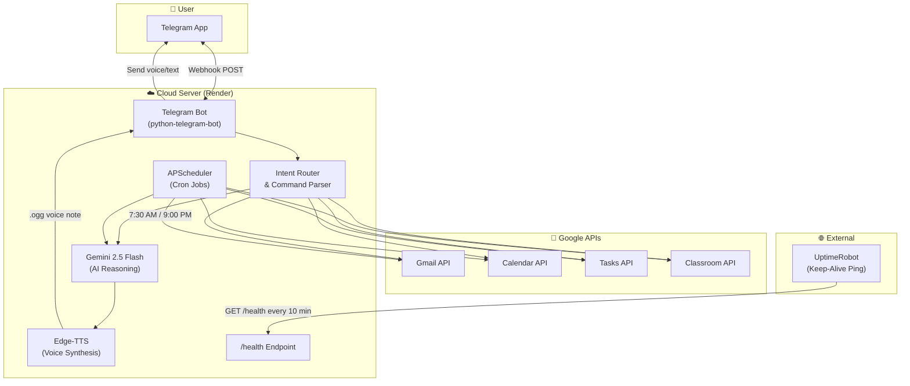
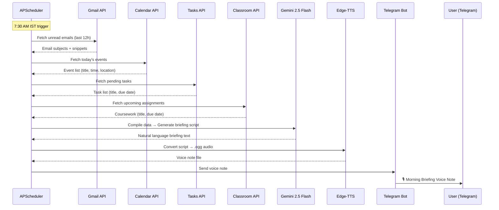

# 🤖 Autonomous AI Personal Assistant — Complete Implementation Guide

> **Goal**: Build a 100% free-forever, 24/7 autonomous AI personal assistant that integrates with Google Workspace (Gmail, Calendar, Tasks, Classroom), uses Gemini AI for reasoning, and communicates through Telegram with dual-daily proactive voice note briefings.

---

## Table of Contents

- [Project File Tree](#project-file-tree)
- [Architecture Overview](#architecture-overview)
- [Data Flow Diagram](#data-flow-diagram)
- [Phase 0: Prerequisites & Environment Setup](#phase-0-prerequisites--environment-setup)
- [Phase 1: Telegram Bot Setup](#phase-1-telegram-bot-setup)
- [Phase 2: Google Cloud Console & OAuth 2.0](#phase-2-google-cloud-console--oauth-20)
- [Phase 3: Google Service Integrations](#phase-3-google-service-integrations)
- [Phase 4: Gemini AI Integration](#phase-4-gemini-ai-integration)
- [Phase 5: Text-to-Speech Pipeline](#phase-5-text-to-speech-pipeline)
- [Phase 6: Core Bot Logic & Command Router](#phase-6-core-bot-logic--command-router)
- [Phase 7: Scheduled Jobs (Cron)](#phase-7-scheduled-jobs-cron)
- [Phase 8: Resilience & Self-Healing](#phase-8-resilience--self-healing)
- [Phase 9: Deployment to Free Cloud](#phase-9-deployment-to-free-cloud)
- [Phase 10: Maintenance & Monitoring](#phase-10-maintenance--monitoring)

---

## Project File Tree

```
ai-assistant/
├── .env                        # Environment variables (NEVER commit this)
├── .env.example                # Template for .env (commit this)
├── .gitignore                  # Git ignore rules
├── requirements.txt            # All Python dependencies (pinned)
├── Dockerfile                  # Container build instructions
├── render.yaml                 # Render deployment config
├── main.py                     # Application entry point
├── config.py                   # Centralized configuration loader
│
├── bot/
│   ├── __init__.py
│   ├── handlers.py             # Telegram message/command handlers
│   ├── router.py               # Intent parser → action dispatcher
│   └── middleware.py           # Auth guard (chat_id restriction)
│
├── google_services/
│   ├── __init__.py
│   ├── auth.py                 # OAuth 2.0 token management
│   ├── gmail_service.py        # Gmail read/filter/summarize
│   ├── calendar_service.py     # Calendar read/create events
│   ├── tasks_service.py        # Tasks read/create/complete
│   └── classroom_service.py    # Classroom courses/assignments
│
├── ai/
│   ├── __init__.py
│   ├── gemini_client.py        # Gemini API wrapper with retry
│   └── prompts.py              # All prompt templates
│
├── tts/
│   ├── __init__.py
│   └── speech.py               # Edge-TTS / gTTS voice generation
│
├── scheduler/
│   ├── __init__.py
│   └── jobs.py                 # APScheduler cron job definitions
│
├── reports/
│   ├── __init__.py
│   ├── morning.py              # Morning briefing pipeline
│   └── evening.py              # Evening report pipeline
│
├── utils/
│   ├── __init__.py
│   ├── retry.py                # Exponential backoff decorator
│   ├── logger.py               # Logging configuration
│   └── health.py               # Health check endpoint
│
├── credentials/
│   ├── .gitkeep                # Placeholder (credentials go here)
│   └── README.md               # "Put credentials.json here"
│
├── audio/                      # Temporary audio files (gitignored)
│   └── .gitkeep
│
└── logs/                       # Log files (gitignored)
    └── .gitkeep
```

---

## Architecture Overview



---

## Data Flow Diagram



---

## Phase 0: Prerequisites & Environment Setup

### 0.1 — Install Python 3.11+

**Windows:**
1. Download from [python.org/downloads](https://www.python.org/downloads/)
2. Run the installer. **Check "Add Python to PATH"** at the bottom of the first screen.
3. Verify installation:
   ```powershell
   python --version
   # Expected: Python 3.11.x or 3.12.x
   pip --version
   # Expected: pip 23.x+
   ```

**Linux / macOS:**
```bash
# Ubuntu/Debian
sudo apt update && sudo apt install python3.11 python3.11-venv python3-pip -y

# macOS (via Homebrew)
brew install python@3.11
```

### 0.2 — Install FFmpeg (Required for Audio Conversion)

Edge-TTS outputs MP3 natively; Telegram voice notes require OGG/Opus. FFmpeg handles the conversion via `pydub`.

**Windows:**
1. Download from [ffmpeg.org/download.html](https://ffmpeg.org/download.html) → Windows builds → `ffmpeg-release-essentials.zip`
2. Extract to `C:\ffmpeg`
3. Add `C:\ffmpeg\bin` to your system PATH:
   - Search "Environment Variables" → System Variables → Path → Edit → New → `C:\ffmpeg\bin`
4. Verify:
   ```powershell
   ffmpeg -version
   ```

**Linux:**
```bash
sudo apt install ffmpeg -y
```

**macOS:**
```bash
brew install ffmpeg
```

### 0.3 — Create Project Directory & Virtual Environment

```powershell
# Create project folder
mkdir ai-assistant
cd ai-assistant

# Create virtual environment
python -m venv venv

# Activate it
# Windows PowerShell:
.\venv\Scripts\Activate.ps1
# Linux/macOS:
# source venv/bin/activate

# Upgrade pip
pip install --upgrade pip
```

### 0.4 — `requirements.txt`

Create `requirements.txt` with these exact pinned dependencies:

```txt
# --- Telegram Bot ---
python-telegram-bot==21.6

# --- Web Server (for webhook mode) ---
starlette==0.41.3
uvicorn==0.32.1
httpx==0.28.1

# --- Google APIs ---
google-api-python-client==2.155.0
google-auth-oauthlib==1.2.1
google-auth-httplib2==0.2.0
google-auth==2.36.0

# --- Gemini AI ---
google-generativeai==0.8.3

# --- Text-to-Speech ---
edge-tts==6.1.18
gTTS==2.5.4
pydub==0.25.1

# --- Scheduling ---
APScheduler==3.10.4

# --- Environment & Config ---
python-dotenv==1.0.1

# --- Retry Logic ---
tenacity==9.0.0

# --- Logging ---
loguru==0.7.3
```

Install everything:
```powershell
pip install -r requirements.txt
```

### 0.5 — `.gitignore`

```gitignore
# Virtual environment
venv/

# Environment variables
.env

# Google OAuth tokens (sensitive!)
credentials/credentials.json
credentials/token.json

# Generated audio files
audio/*.ogg
audio/*.mp3

# Logs
logs/*.log

# Python cache
__pycache__/
*.pyc
*.pyo

# IDE
.vscode/
.idea/

# OS
.DS_Store
Thumbs.db
```

### 0.6 — Environment Variables (`.env`)

Create `.env` in the project root:

```env
# ============================================================
#  AI ASSISTANT — ENVIRONMENT CONFIGURATION
# ============================================================

# --- Telegram ---
TELEGRAM_BOT_TOKEN=your_bot_token_from_botfather
TELEGRAM_CHAT_ID=your_personal_chat_id
TELEGRAM_WEBHOOK_URL=https://your-app.onrender.com

# --- Google OAuth ---
GOOGLE_CREDENTIALS_PATH=credentials/credentials.json
GOOGLE_TOKEN_PATH=credentials/token.json

# --- Gemini AI ---
GEMINI_API_KEY=your_gemini_api_key_from_ai_studio

# --- TTS ---
TTS_VOICE=en-US-AriaNeural
TTS_FALLBACK_VOICE=en-US-JennyNeural
AUDIO_OUTPUT_DIR=audio

# --- Scheduler ---
TIMEZONE=Asia/Kolkata
MORNING_REPORT_HOUR=7
MORNING_REPORT_MINUTE=30
EVENING_REPORT_HOUR=21
EVENING_REPORT_MINUTE=0

# --- Server ---
PORT=8000
LOG_LEVEL=INFO
LOG_FILE=logs/assistant.log

# --- Admin Alerts ---
SEND_ERROR_ALERTS=true
```

Also create `.env.example` with the same content but placeholder values, and commit it to version control.

### Environment Variables Reference

| Variable | Description | Where to Get It |
|---|---|---|
| `TELEGRAM_BOT_TOKEN` | Bot API token | @BotFather on Telegram (Phase 1) |
| `TELEGRAM_CHAT_ID` | Your personal numeric chat ID | @userinfobot on Telegram (Phase 1) |
| `TELEGRAM_WEBHOOK_URL` | Public HTTPS URL of your server | Your Render/Zeabur deploy URL (Phase 9) |
| `GOOGLE_CREDENTIALS_PATH` | Path to OAuth client secret file | Google Cloud Console (Phase 2) |
| `GOOGLE_TOKEN_PATH` | Path to stored auth tokens | Generated on first OAuth flow (Phase 2) |
| `GEMINI_API_KEY` | Gemini API key | Google AI Studio (Phase 4) |
| `TTS_VOICE` | Primary Edge-TTS voice name | `edge-tts --list-voices` (Phase 5) |
| `TTS_FALLBACK_VOICE` | Backup voice if primary fails | `edge-tts --list-voices` (Phase 5) |
| `AUDIO_OUTPUT_DIR` | Directory for temp audio files | Default: `audio` |
| `TIMEZONE` | IANA timezone for scheduler | `Asia/Kolkata` for IST |
| `MORNING_REPORT_HOUR` | Hour for morning briefing (24h) | `7` = 7 AM |
| `MORNING_REPORT_MINUTE` | Minute for morning briefing | `30` = :30 |
| `EVENING_REPORT_HOUR` | Hour for evening report (24h) | `21` = 9 PM |
| `EVENING_REPORT_MINUTE` | Minute for evening report | `0` = :00 |
| `PORT` | Server port for webhook | Default: `8000` |
| `LOG_LEVEL` | Logging verbosity | `DEBUG`, `INFO`, `WARNING`, `ERROR` |
| `SEND_ERROR_ALERTS` | Send crash alerts to Telegram | `true` or `false` |

### 0.7 — `config.py` (Centralized Configuration Loader)

```python
"""
config.py — Loads all environment variables with validation.
"""
import os
import sys
from dotenv import load_dotenv

load_dotenv()


def _require(var_name: str) -> str:
    """Get a required environment variable or exit with error."""
    value = os.getenv(var_name)
    if not value:
        print(f"❌ FATAL: Required environment variable '{var_name}' is not set.")
        sys.exit(1)
    return value


# --- Telegram ---
TELEGRAM_BOT_TOKEN: str = _require("TELEGRAM_BOT_TOKEN")
TELEGRAM_CHAT_ID: int = int(_require("TELEGRAM_CHAT_ID"))
TELEGRAM_WEBHOOK_URL: str = os.getenv("TELEGRAM_WEBHOOK_URL", "")

# --- Google OAuth ---
GOOGLE_CREDENTIALS_PATH: str = os.getenv("GOOGLE_CREDENTIALS_PATH", "credentials/credentials.json")
GOOGLE_TOKEN_PATH: str = os.getenv("GOOGLE_TOKEN_PATH", "credentials/token.json")

# --- Gemini AI ---
GEMINI_API_KEY: str = _require("GEMINI_API_KEY")

# --- TTS ---
TTS_VOICE: str = os.getenv("TTS_VOICE", "en-US-AriaNeural")
TTS_FALLBACK_VOICE: str = os.getenv("TTS_FALLBACK_VOICE", "en-US-JennyNeural")
AUDIO_OUTPUT_DIR: str = os.getenv("AUDIO_OUTPUT_DIR", "audio")

# --- Scheduler ---
TIMEZONE: str = os.getenv("TIMEZONE", "Asia/Kolkata")
MORNING_REPORT_HOUR: int = int(os.getenv("MORNING_REPORT_HOUR", "7"))
MORNING_REPORT_MINUTE: int = int(os.getenv("MORNING_REPORT_MINUTE", "30"))
EVENING_REPORT_HOUR: int = int(os.getenv("EVENING_REPORT_HOUR", "21"))
EVENING_REPORT_MINUTE: int = int(os.getenv("EVENING_REPORT_MINUTE", "0"))

# --- Server ---
PORT: int = int(os.getenv("PORT", "8000"))
LOG_LEVEL: str = os.getenv("LOG_LEVEL", "INFO")
LOG_FILE: str = os.getenv("LOG_FILE", "logs/assistant.log")

# --- Admin Alerts ---
SEND_ERROR_ALERTS: bool = os.getenv("SEND_ERROR_ALERTS", "true").lower() == "true"

# --- Google API Scopes ---
GOOGLE_SCOPES: list[str] = [
    "https://www.googleapis.com/auth/gmail.readonly",
    "https://www.googleapis.com/auth/gmail.modify",
    "https://www.googleapis.com/auth/calendar",
    "https://www.googleapis.com/auth/calendar.events",
    "https://www.googleapis.com/auth/tasks",
    "https://www.googleapis.com/auth/classroom.courses.readonly",
    "https://www.googleapis.com/auth/classroom.coursework.me.readonly",
    "https://www.googleapis.com/auth/classroom.announcements.readonly",
]
```

### Google API Scopes Reference

| Scope | Purpose | Access Level |
|---|---|---|
| `gmail.readonly` | Read email messages and metadata | Read-only |
| `gmail.modify` | Mark emails as read, archive | Read + modify |
| `calendar` | Full calendar access | Read + Write |
| `calendar.events` | Create/edit/delete events | Read + Write |
| `tasks` | Full tasks access | Read + Write |
| `classroom.courses.readonly` | List enrolled courses | Read-only |
| `classroom.coursework.me.readonly` | View assignments for the user | Read-only |
| `classroom.announcements.readonly` | View class announcements | Read-only |

---

## Phase 1: Telegram Bot Setup

### 1.1 — Create a Bot via @BotFather

1. Open Telegram and search for **@BotFather** (the official Telegram bot for creating bots — verified with a blue checkmark).
2. Send `/start` to BotFather.
3. Send `/newbot`.
4. When prompted, enter a **display name** for your bot (e.g., `My AI Assistant`).
5. When prompted, enter a **username** for your bot. It must end in `bot` (e.g., `my_ai_assistant_bot`).
6. BotFather will reply with your **bot token**. It looks like this:
   ```
   7123456789:AAH1bGciOiJSUzI1NiIsInR5cCI6IkpXVCJ9
   ```
7. **Copy this token** and paste it into your `.env` file as `TELEGRAM_BOT_TOKEN`.

> [!CAUTION]
> Your bot token is a **secret key**. Anyone with this token can control your bot. Never commit it to Git, never share it publicly. If compromised, immediately regenerate it via BotFather → `/revoke`.

### 1.2 — Get Your Personal Chat ID

You need your numeric Telegram chat ID to restrict the bot so **only you** can use it.

1. Open Telegram and search for **@userinfobot**.
2. Send `/start` to it.
3. It will reply with your user info, including your numeric **Id** (e.g., `123456789`).
4. Copy this number and paste it into `.env` as `TELEGRAM_CHAT_ID`.

### 1.3 — Optional Bot Configuration via BotFather

Send these commands to @BotFather to polish your bot:
- `/setdescription` — Set what users see when they first open your bot.
- `/setabouttext` — Set the bio in the bot's profile.
- `/setuserpic` — Upload a profile picture for the bot.
- `/setcommands` — Register slash commands (enables autocomplete in Telegram):
  ```
  status - Check system status
  morning - Trigger morning briefing now
  evening - Trigger evening report now
  schedule - Schedule a calendar event
  task - Create a new task
  emails - Get email summary
  classes - Get classroom updates
  help - Show available commands
  ```

### 1.4 — Webhook vs Polling

| Feature | Polling | Webhook |
|---|---|---|
| **How it works** | Bot repeatedly asks Telegram "any new messages?" | Telegram pushes new messages to your URL |
| **Latency** | Higher (polls every N seconds) | Near-instant |
| **Resource usage** | Higher (constant HTTP requests) | Lower (only fires on events) |
| **Requires public URL** | ❌ No | ✅ Yes (HTTPS) |
| **Best for** | Local development | Production deployment |

**Strategy**: Use **polling** during local development, **webhook** in production.

### 1.5 — Basic Bot Echo Test (Polling Mode)

Create a quick test file `test_bot.py` to verify your token works:

```python
"""
test_bot.py — Quick echo test to verify the bot token works.
Run locally: python test_bot.py
"""
import asyncio
from telegram import Update
from telegram.ext import (
    Application,
    CommandHandler,
    MessageHandler,
    ContextTypes,
    filters,
)


BOT_TOKEN = "YOUR_BOT_TOKEN_HERE"  # Paste your token directly for testing
ALLOWED_CHAT_ID = 123456789  # Your chat ID


async def start(update: Update, context: ContextTypes.DEFAULT_TYPE) -> None:
    if update.effective_chat.id != ALLOWED_CHAT_ID:
        await update.message.reply_text("⛔ Unauthorized.")
        return
    await update.message.reply_text(
        "✅ Bot is working! I'm your AI assistant. Send me any message."
    )


async def echo(update: Update, context: ContextTypes.DEFAULT_TYPE) -> None:
    if update.effective_chat.id != ALLOWED_CHAT_ID:
        return
    await update.message.reply_text(f"🔁 Echo: {update.message.text}")


def main() -> None:
    app = Application.builder().token(BOT_TOKEN).build()
    app.add_handler(CommandHandler("start", start))
    app.add_handler(MessageHandler(filters.TEXT & ~filters.COMMAND, echo))

    print("🤖 Bot is running in polling mode. Press Ctrl+C to stop.")
    app.run_polling(allowed_updates=Update.ALL_TYPES)


if __name__ == "__main__":
    main()
```

Run it:
```powershell
python test_bot.py
```

Open Telegram, go to your bot, send `/start`. You should see `✅ Bot is working!`. Send any text and get an echo. Press `Ctrl+C` to stop.

### 1.6 — Auth Middleware (`bot/middleware.py`)

```python
"""
bot/middleware.py — Restricts bot access to the authorized chat_id only.
"""
from telegram import Update
from telegram.ext import ContextTypes
from config import TELEGRAM_CHAT_ID
from utils.logger import logger


def authorized_only(func):
    """Decorator that blocks unauthorized users from accessing bot commands."""
    async def wrapper(update: Update, context: ContextTypes.DEFAULT_TYPE, *args, **kwargs):
        chat_id = update.effective_chat.id
        if chat_id != TELEGRAM_CHAT_ID:
            logger.warning(
                f"⛔ Unauthorized access attempt from chat_id={chat_id}, "
                f"user={update.effective_user.username}"
            )
            await update.message.reply_text("⛔ Unauthorized. This bot is private.")
            return
        return await func(update, context, *args, **kwargs)
    return wrapper
```

---

## Phase 2: Google Cloud Console & OAuth 2.0

### 2.1 — Create a Google Cloud Project

1. Go to [console.cloud.google.com](https://console.cloud.google.com/).
2. Sign in with the Google account whose Gmail/Calendar/Tasks/Classroom you want to access.
3. Click the project dropdown at the top → **"New Project"**.
4. Project name: `AI-Assistant` (or anything you like).
5. Click **Create**. Wait a few seconds.
6. Make sure the new project is selected in the dropdown.

### 2.2 — Enable Required APIs

In the Google Cloud Console, navigate to **APIs & Services → Library**. Search for and **enable** each of these APIs (click the API name → click "Enable"):

| API | Search Term | Purpose |
|---|---|---|
| Gmail API | `Gmail API` | Read and manage emails |
| Google Calendar API | `Google Calendar API` | Read/create calendar events |
| Google Tasks API | `Tasks API` | Read/create tasks |
| Google Classroom API | `Google Classroom API` | Read courses & assignments |

### 2.3 — Configure OAuth Consent Screen

1. Go to **APIs & Services → OAuth consent screen**.
2. Select **External** user type → Click **Create**.
3. Fill in:
   - **App name**: `AI Assistant`
   - **User support email**: your email
   - **Developer contact info**: your email
4. Click **Save and Continue**.
5. On the **Scopes** page, click **Add or Remove Scopes**. Add all the scopes from the table in Phase 0 (search for each one). Click **Update** then **Save and Continue**.
6. On the **Test users** page, click **+ Add Users**. Enter your **own Google email address**. Click **Add** then **Save and Continue**.
7. Click **Back to Dashboard**.

> [!IMPORTANT]
> While your app is in **"Testing"** status, only users listed as Test Users can authenticate. This is fine — you only need yourself. The app can stay in Testing mode forever for personal use. Do **not** publish it to production (that would require Google's review).

### 2.4 — Create OAuth 2.0 Credentials

1. Go to **APIs & Services → Credentials**.
2. Click **+ Create Credentials → OAuth client ID**.
3. Application type: **Desktop app**.
4. Name: `AI Assistant Desktop Client`.
5. Click **Create**.
6. A dialog will show your Client ID and Client Secret. Click **Download JSON**.
7. Rename the downloaded file to `credentials.json`.
8. Move it to your project's `credentials/` folder:
   ```
   ai-assistant/credentials/credentials.json
   ```

### 2.5 — Google OAuth Auth Module (`google_services/auth.py`)

This module handles the entire OAuth lifecycle: first-time browser consent, token saving, automatic refresh, and edge-case recovery.

```python
"""
google_services/auth.py — Google OAuth 2.0 token management.
Handles first-time auth, automatic refresh, and token persistence.
"""
import os
from google.auth.transport.requests import Request
from google.oauth2.credentials import Credentials
from google_auth_oauthlib.flow import InstalledAppFlow
from googleapiclient.discovery import build
from config import GOOGLE_CREDENTIALS_PATH, GOOGLE_TOKEN_PATH, GOOGLE_SCOPES
from utils.logger import logger


def get_google_credentials() -> Credentials:
    """
    Get valid Google OAuth credentials.
    
    Flow:
    1. If token.json exists and is valid → use it directly.
    2. If token.json exists but is expired → auto-refresh using refresh_token.
    3. If no token.json exists → launch browser OAuth consent flow.
    
    Returns:
        google.oauth2.credentials.Credentials: Valid credentials object.
    
    Raises:
        FileNotFoundError: If credentials.json is missing.
        Exception: If OAuth flow fails.
    """
    creds = None

    # Step 1: Try loading existing token
    if os.path.exists(GOOGLE_TOKEN_PATH):
        try:
            creds = Credentials.from_authorized_user_file(GOOGLE_TOKEN_PATH, GOOGLE_SCOPES)
            logger.debug("Loaded existing token from disk.")
        except Exception as e:
            logger.warning(f"Failed to load token.json: {e}. Will re-authenticate.")
            creds = None

    # Step 2: Validate or refresh
    if creds and creds.valid:
        logger.debug("Token is valid. No refresh needed.")
        return creds

    if creds and creds.expired and creds.refresh_token:
        try:
            logger.info("Token expired. Refreshing...")
            creds.refresh(Request())
            logger.info("✅ Token refreshed successfully.")
            _save_token(creds)
            return creds
        except Exception as e:
            logger.error(f"Token refresh failed: {e}. Will re-authenticate.")
            creds = None

    # Step 3: Full OAuth flow (first-time or recovery)
    if not os.path.exists(GOOGLE_CREDENTIALS_PATH):
        raise FileNotFoundError(
            f"❌ credentials.json not found at '{GOOGLE_CREDENTIALS_PATH}'. "
            f"Download it from Google Cloud Console → APIs & Services → Credentials."
        )

    logger.info("Starting OAuth consent flow. A browser window will open...")
    flow = InstalledAppFlow.from_client_secrets_file(GOOGLE_CREDENTIALS_PATH, GOOGLE_SCOPES)
    creds = flow.run_local_server(port=0)
    logger.info("✅ OAuth consent completed successfully.")
    _save_token(creds)
    return creds


def _save_token(creds: Credentials) -> None:
    """Save credentials to token.json file."""
    os.makedirs(os.path.dirname(GOOGLE_TOKEN_PATH), exist_ok=True)
    with open(GOOGLE_TOKEN_PATH, "w") as token_file:
        token_file.write(creds.to_json())
    logger.debug(f"Token saved to {GOOGLE_TOKEN_PATH}")


def build_service(api_name: str, api_version: str):
    """
    Build a Google API service client.
    
    Args:
        api_name: API name (e.g., 'gmail', 'calendar', 'tasks', 'classroom').
        api_version: API version (e.g., 'v1', 'v3').
    
    Returns:
        googleapiclient.discovery.Resource: Authenticated API service client.
    """
    creds = get_google_credentials()
    service = build(api_name, api_version, credentials=creds)
    logger.debug(f"Built {api_name} {api_version} service client.")
    return service
```

### 2.6 — First-Time Token Generation

The first time you run the app (locally), a browser window will open asking you to sign in and grant permissions. This **only happens once**.

```powershell
# Run this one-time script locally to generate token.json
python -c "from google_services.auth import get_google_credentials; get_google_credentials()"
```

1. A browser window opens → Sign in with your Google account.
2. You'll see a warning "Google hasn't verified this app" → Click **Continue**.
3. Review and grant all requested permissions → Click **Continue**.
4. You'll see "The authentication flow has completed" → Close the browser.
5. Check that `credentials/token.json` was created.

> [!WARNING]
> **On a headless server** (no browser), you cannot do the OAuth consent flow. You must generate `token.json` locally first, then upload it to the server. The token auto-refreshes indefinitely — you'll never need a browser again.

### 2.7 — Token Expiry Edge Cases

| Scenario | What Happens | Solution |
|---|---|---|
| Access token expires (every ~1 hour) | `creds.expired` becomes `True` | Auto-handled by `creds.refresh(Request())` |
| Refresh token is revoked (user revokes app access) | `RefreshError` exception | Delete `token.json`, re-run OAuth flow locally |
| Scopes changed in code | Token scopes don't match | Delete `token.json`, re-run OAuth flow |
| `credentials.json` is missing | `FileNotFoundError` | Re-download from Google Cloud Console |
| Google server error during refresh | `TransportError` | Retry with exponential backoff (handled by retry decorator) |

---

## Phase 3: Google Service Integrations

### 3.1 — Gmail Service (`google_services/gmail_service.py`)

```python
"""
google_services/gmail_service.py — Gmail read, filter, and summarize.
"""
import base64
from datetime import datetime, timedelta
from typing import Optional
from google_services.auth import build_service
from utils.logger import logger
from utils.retry import retry_on_failure


@retry_on_failure(max_retries=3)
def get_unread_emails(
    max_results: int = 20,
    hours_back: int = 12,
    skip_categories: list[str] | None = None,
) -> list[dict]:
    """
    Fetch unread emails from the past N hours.

    Args:
        max_results: Maximum number of emails to return.
        hours_back: How far back to look (in hours).
        skip_categories: Gmail categories to skip (e.g., ['promotions', 'social', 'updates']).

    Returns:
        List of dicts with keys: id, subject, sender, snippet, date, labels.
    """
    if skip_categories is None:
        skip_categories = ["promotions", "social", "updates", "forums"]

    service = build_service("gmail", "v1")

    # Build query string
    after_date = datetime.utcnow() - timedelta(hours=hours_back)
    after_epoch = int(after_date.timestamp())
    query = f"is:unread after:{after_epoch}"

    # Add category exclusions
    for category in skip_categories:
        query += f" -category:{category}"

    logger.info(f"Gmail query: {query}")

    results = (
        service.users()
        .messages()
        .list(userId="me", q=query, maxResults=max_results)
        .execute()
    )

    messages = results.get("messages", [])
    if not messages:
        logger.info("No unread emails found.")
        return []

    emails = []
    for msg_ref in messages:
        msg = (
            service.users()
            .messages()
            .get(userId="me", id=msg_ref["id"], format="metadata",
                 metadataHeaders=["Subject", "From", "Date"])
            .execute()
        )

        headers = {h["name"]: h["value"] for h in msg.get("payload", {}).get("headers", [])}
        emails.append({
            "id": msg["id"],
            "subject": headers.get("Subject", "(No Subject)"),
            "sender": headers.get("From", "(Unknown Sender)"),
            "snippet": msg.get("snippet", ""),
            "date": headers.get("Date", ""),
            "labels": msg.get("labelIds", []),
        })

    logger.info(f"Fetched {len(emails)} unread emails.")
    return emails


@retry_on_failure(max_retries=3)
def get_email_body(message_id: str) -> str:
    """
    Get the full body text of an email by its message ID.

    Args:
        message_id: The Gmail message ID.

    Returns:
        Decoded plain-text body of the email.
    """
    service = build_service("gmail", "v1")
    msg = service.users().messages().get(userId="me", id=message_id, format="full").execute()

    payload = msg.get("payload", {})
    body_text = _extract_body(payload)
    return body_text


def _extract_body(payload: dict) -> str:
    """Recursively extract plain text from email payload."""
    if payload.get("mimeType") == "text/plain":
        data = payload.get("body", {}).get("data", "")
        if data:
            return base64.urlsafe_b64decode(data).decode("utf-8", errors="replace")

    # Check parts (multipart emails)
    for part in payload.get("parts", []):
        result = _extract_body(part)
        if result:
            return result

    return ""


@retry_on_failure(max_retries=3)
def mark_as_read(message_id: str) -> None:
    """
    Mark an email as read by removing the UNREAD label.

    Args:
        message_id: The Gmail message ID to mark as read.
    """
    service = build_service("gmail", "v1")
    service.users().messages().modify(
        userId="me",
        id=message_id,
        body={"removeLabelIds": ["UNREAD"]},
    ).execute()
    logger.debug(f"Marked message {message_id} as read.")
```

### 3.2 — Google Calendar Service (`google_services/calendar_service.py`)

```python
"""
google_services/calendar_service.py — Calendar read and event creation.
"""
from datetime import datetime, timedelta
from zoneinfo import ZoneInfo
from typing import Optional
from google_services.auth import build_service
from config import TIMEZONE
from utils.logger import logger
from utils.retry import retry_on_failure


@retry_on_failure(max_retries=3)
def get_todays_events() -> list[dict]:
    """
    Fetch all events for today from the primary calendar.

    Returns:
        List of dicts with keys: id, summary, start, end, location, description.
    """
    service = build_service("calendar", "v3")
    tz = ZoneInfo(TIMEZONE)
    now = datetime.now(tz)

    # Start of today and end of today
    start_of_day = now.replace(hour=0, minute=0, second=0, microsecond=0)
    end_of_day = start_of_day + timedelta(days=1)

    events_result = (
        service.events()
        .list(
            calendarId="primary",
            timeMin=start_of_day.isoformat(),
            timeMax=end_of_day.isoformat(),
            singleEvents=True,
            orderBy="startTime",
        )
        .execute()
    )

    events = events_result.get("items", [])
    parsed = []
    for event in events:
        start = event["start"].get("dateTime", event["start"].get("date"))
        end = event["end"].get("dateTime", event["end"].get("date"))
        parsed.append({
            "id": event.get("id"),
            "summary": event.get("summary", "(No Title)"),
            "start": start,
            "end": end,
            "location": event.get("location", ""),
            "description": event.get("description", ""),
        })

    logger.info(f"Found {len(parsed)} events for today.")
    return parsed


@retry_on_failure(max_retries=3)
def get_upcoming_events(days: int = 7, max_results: int = 20) -> list[dict]:
    """
    Fetch upcoming events for the next N days.

    Args:
        days: Number of days to look ahead.
        max_results: Maximum number of events to return.

    Returns:
        List of event dicts.
    """
    service = build_service("calendar", "v3")
    tz = ZoneInfo(TIMEZONE)
    now = datetime.now(tz)
    future = now + timedelta(days=days)

    events_result = (
        service.events()
        .list(
            calendarId="primary",
            timeMin=now.isoformat(),
            timeMax=future.isoformat(),
            maxResults=max_results,
            singleEvents=True,
            orderBy="startTime",
        )
        .execute()
    )

    events = events_result.get("items", [])
    parsed = []
    for event in events:
        start = event["start"].get("dateTime", event["start"].get("date"))
        end = event["end"].get("dateTime", event["end"].get("date"))
        parsed.append({
            "id": event.get("id"),
            "summary": event.get("summary", "(No Title)"),
            "start": start,
            "end": end,
            "location": event.get("location", ""),
            "description": event.get("description", ""),
        })

    return parsed


@retry_on_failure(max_retries=3)
def create_event(
    summary: str,
    start_datetime: str,
    end_datetime: str,
    description: str = "",
    location: str = "",
    attendees: list[str] | None = None,
) -> dict:
    """
    Create a new Google Calendar event.

    Args:
        summary: Event title.
        start_datetime: ISO 8601 datetime string (e.g., '2025-01-15T14:00:00+05:30').
        end_datetime: ISO 8601 datetime string.
        description: Optional event description.
        location: Optional event location.
        attendees: Optional list of email addresses to invite.

    Returns:
        Dict with created event details including 'id' and 'htmlLink'.
    """
    service = build_service("calendar", "v3")

    event_body = {
        "summary": summary,
        "location": location,
        "description": description,
        "start": {
            "dateTime": start_datetime,
            "timeZone": TIMEZONE,
        },
        "end": {
            "dateTime": end_datetime,
            "timeZone": TIMEZONE,
        },
    }

    if attendees:
        event_body["attendees"] = [{"email": email} for email in attendees]

    created_event = service.events().insert(calendarId="primary", body=event_body).execute()

    logger.info(f"✅ Created event: '{summary}' → {created_event.get('htmlLink')}")
    return {
        "id": created_event["id"],
        "summary": created_event.get("summary"),
        "start": created_event["start"].get("dateTime"),
        "end": created_event["end"].get("dateTime"),
        "link": created_event.get("htmlLink"),
    }
```

### 3.3 — Google Tasks Service (`google_services/tasks_service.py`)

```python
"""
google_services/tasks_service.py — Google Tasks read, create, and complete.
"""
from typing import Optional
from google_services.auth import build_service
from utils.logger import logger
from utils.retry import retry_on_failure


@retry_on_failure(max_retries=3)
def get_task_lists() -> list[dict]:
    """
    Fetch all task lists.

    Returns:
        List of dicts with keys: id, title.
    """
    service = build_service("tasks", "v1")
    results = service.tasklists().list(maxResults=100).execute()
    task_lists = results.get("items", [])
    return [{"id": tl["id"], "title": tl["title"]} for tl in task_lists]


@retry_on_failure(max_retries=3)
def get_pending_tasks(task_list_id: str = "@default") -> list[dict]:
    """
    Fetch all pending (incomplete) tasks from a task list.

    Args:
        task_list_id: Task list ID. Use "@default" for the default list.

    Returns:
        List of dicts with keys: id, title, due, notes, status.
    """
    service = build_service("tasks", "v1")
    results = (
        service.tasks()
        .list(
            tasklist=task_list_id,
            showCompleted=False,
            showHidden=False,
            maxResults=100,
        )
        .execute()
    )

    tasks = results.get("items", [])
    parsed = []
    for task in tasks:
        parsed.append({
            "id": task.get("id"),
            "title": task.get("title", "(Untitled)"),
            "due": task.get("due", None),  # RFC 3339 date string
            "notes": task.get("notes", ""),
            "status": task.get("status", "needsAction"),
        })

    logger.info(f"Found {len(parsed)} pending tasks.")
    return parsed


@retry_on_failure(max_retries=3)
def create_task(
    title: str,
    notes: str = "",
    due_date: str | None = None,
    task_list_id: str = "@default",
) -> dict:
    """
    Create a new task.

    Args:
        title: Task title.
        notes: Optional task description/notes.
        due_date: Optional due date in RFC 3339 format (e.g., '2025-01-15T00:00:00.000Z').
        task_list_id: Task list to add to. Use "@default" for the default list.

    Returns:
        Dict with created task details.
    """
    service = build_service("tasks", "v1")

    task_body = {"title": title}
    if notes:
        task_body["notes"] = notes
    if due_date:
        task_body["due"] = due_date

    created = service.tasks().insert(tasklist=task_list_id, body=task_body).execute()
    logger.info(f"✅ Created task: '{title}'")
    return {
        "id": created["id"],
        "title": created.get("title"),
        "due": created.get("due"),
        "status": created.get("status"),
    }


@retry_on_failure(max_retries=3)
def complete_task(task_id: str, task_list_id: str = "@default") -> None:
    """
    Mark a task as completed.

    Args:
        task_id: The task ID.
        task_list_id: The task list ID containing the task.
    """
    service = build_service("tasks", "v1")
    service.tasks().patch(
        tasklist=task_list_id,
        task=task_id,
        body={"status": "completed"},
    ).execute()
    logger.info(f"✅ Completed task {task_id}")
```

### 3.4 — Google Classroom Service (`google_services/classroom_service.py`)

```python
"""
google_services/classroom_service.py — Classroom courses, assignments, and announcements.
"""
from google_services.auth import build_service
from utils.logger import logger
from utils.retry import retry_on_failure


@retry_on_failure(max_retries=3)
def get_active_courses() -> list[dict]:
    """
    Fetch all active courses the user is enrolled in.

    Returns:
        List of dicts with keys: id, name, section, teacher.
    """
    service = build_service("classroom", "v1")
    results = service.courses().list(courseStates=["ACTIVE"], pageSize=30).execute()
    courses = results.get("courses", [])

    parsed = []
    for course in courses:
        parsed.append({
            "id": course["id"],
            "name": course.get("name", "(Unnamed Course)"),
            "section": course.get("section", ""),
            "description": course.get("description", ""),
            "enrollment_code": course.get("enrollmentCode", ""),
        })

    logger.info(f"Found {len(parsed)} active courses.")
    return parsed


@retry_on_failure(max_retries=3)
def get_coursework(course_id: str, max_results: int = 10) -> list[dict]:
    """
    Fetch coursework (assignments) for a specific course.

    Args:
        course_id: The Classroom course ID.
        max_results: Maximum number of assignments to return.

    Returns:
        List of dicts with keys: id, title, description, due_date, due_time,
        max_points, state, link.
    """
    service = build_service("classroom", "v1")

    results = (
        service.courses()
        .courseWork()
        .list(courseId=course_id, pageSize=max_results, orderBy="dueDate desc")
        .execute()
    )

    coursework = results.get("courseWork", [])
    parsed = []
    for cw in coursework:
        due = cw.get("dueDate", {})
        due_time = cw.get("dueTime", {})

        due_str = ""
        if due:
            due_str = f"{due.get('year', '?')}-{due.get('month', '?'):02d}-{due.get('day', '?'):02d}"
            if due_time:
                due_str += f" {due_time.get('hours', 0):02d}:{due_time.get('minutes', 0):02d}"

        parsed.append({
            "id": cw["id"],
            "title": cw.get("title", "(Untitled)"),
            "description": cw.get("description", ""),
            "due_date": due_str,
            "max_points": cw.get("maxPoints", 0),
            "state": cw.get("state", ""),
            "link": cw.get("alternateLink", ""),
        })

    logger.info(f"Found {len(parsed)} coursework items for course {course_id}.")
    return parsed


@retry_on_failure(max_retries=3)
def get_announcements(course_id: str, max_results: int = 5) -> list[dict]:
    """
    Fetch announcements for a specific course.

    Args:
        course_id: The Classroom course ID.
        max_results: Maximum number of announcements.

    Returns:
        List of dicts with keys: id, text, creation_time, creator.
    """
    service = build_service("classroom", "v1")

    results = (
        service.courses()
        .announcements()
        .list(courseId=course_id, pageSize=max_results, orderBy="updateTime desc")
        .execute()
    )

    announcements = results.get("announcements", [])
    parsed = []
    for ann in announcements:
        parsed.append({
            "id": ann["id"],
            "text": ann.get("text", ""),
            "creation_time": ann.get("creationTime", ""),
            "update_time": ann.get("updateTime", ""),
        })

    return parsed


@retry_on_failure(max_retries=3)
def get_all_upcoming_assignments() -> list[dict]:
    """
    Fetch upcoming assignments from ALL active courses.

    Returns:
        List of dicts with added 'course_name' key.
    """
    courses = get_active_courses()
    all_assignments = []

    for course in courses:
        try:
            coursework = get_coursework(course["id"], max_results=5)
            for cw in coursework:
                cw["course_name"] = course["name"]
            all_assignments.extend(coursework)
        except Exception as e:
            logger.warning(f"Failed to fetch coursework for '{course['name']}': {e}")

    # Sort by due date
    all_assignments.sort(key=lambda x: x.get("due_date", "9999"))
    logger.info(f"Total upcoming assignments across all courses: {len(all_assignments)}")
    return all_assignments
```

---

## Phase 4: Gemini AI Integration

### 4.1 — Get Your API Key

1. Go to [aistudio.google.com](https://aistudio.google.com/).
2. Sign in with your Google account.
3. Click **"Get API key"** in the left sidebar (or top navigation).
4. Click **"Create API key"**.
5. Select your Google Cloud project (the one you created in Phase 2).
6. Copy the generated API key.
7. Paste it into your `.env` as `GEMINI_API_KEY`.

### Gemini 2.5 Flash Free Tier Limits

| Limit | Value |
|---|---|
| Requests per minute (RPM) | ~10–15 |
| Requests per day (RPD) | ~1,500 |
| Tokens per minute (TPM) | ~250,000–1,000,000 |
| Context window | 1,000,000 tokens |
| Cost | $0.00 (free forever on free tier) |

> [!NOTE]
> With 2 daily reports + ~10–20 ad-hoc commands per day, you'll use roughly 25–50 requests/day — well within the 1,500 RPD limit.

### 4.2 — Gemini Client (`ai/gemini_client.py`)

```python
"""
ai/gemini_client.py — Gemini 2.5 Flash API wrapper with retry logic.
"""
import json
from typing import Optional
import google.generativeai as genai
from google.api_core.exceptions import ResourceExhausted, GoogleAPIError
from config import GEMINI_API_KEY
from utils.logger import logger
from utils.retry import retry_on_failure

# Configure the SDK
genai.configure(api_key=GEMINI_API_KEY)

# Initialize the model
model = genai.GenerativeModel(
    model_name="gemini-2.5-flash",
    generation_config={
        "temperature": 0.7,
        "top_p": 0.95,
        "top_k": 40,
        "max_output_tokens": 4096,
    },
)


@retry_on_failure(max_retries=5, base_delay=2.0, exceptions=(ResourceExhausted,))
def generate_text(prompt: str, system_instruction: str = "") -> str:
    """
    Generate text using Gemini 2.5 Flash.

    Args:
        prompt: The user/content prompt.
        system_instruction: Optional system instruction to guide behavior.

    Returns:
        Generated text string.

    Raises:
        ResourceExhausted: If rate limit is exceeded after all retries.
        GoogleAPIError: If the API returns an error.
    """
    try:
        if system_instruction:
            model_with_system = genai.GenerativeModel(
                model_name="gemini-2.5-flash",
                system_instruction=system_instruction,
                generation_config={
                    "temperature": 0.7,
                    "top_p": 0.95,
                    "top_k": 40,
                    "max_output_tokens": 4096,
                },
            )
            response = model_with_system.generate_content(prompt)
        else:
            response = model.generate_content(prompt)

        if response.text:
            return response.text.strip()
        else:
            logger.warning("Gemini returned empty response.")
            return "(AI returned no content)"

    except ResourceExhausted:
        logger.warning("Gemini rate limit hit (429). Will retry with backoff...")
        raise  # Let the retry decorator handle it
    except GoogleAPIError as e:
        logger.error(f"Gemini API error: {e}")
        raise
    except Exception as e:
        logger.error(f"Unexpected Gemini error: {e}")
        raise


@retry_on_failure(max_retries=5, base_delay=2.0, exceptions=(ResourceExhausted,))
def generate_json(prompt: str, system_instruction: str = "") -> dict:
    """
    Generate structured JSON output using Gemini 2.5 Flash.

    Args:
        prompt: The prompt requesting JSON output.
        system_instruction: Optional system instruction.

    Returns:
        Parsed JSON dict.

    Raises:
        json.JSONDecodeError: If the AI output is not valid JSON.
    """
    json_system = (
        system_instruction + "\n\n" if system_instruction else ""
    ) + "You MUST respond with valid JSON only. No markdown fences, no extra text."

    text = generate_text(prompt, system_instruction=json_system)

    # Strip any markdown code fences if present
    text = text.strip()
    if text.startswith("```json"):
        text = text[7:]
    if text.startswith("```"):
        text = text[3:]
    if text.endswith("```"):
        text = text[:-3]
    text = text.strip()

    try:
        return json.loads(text)
    except json.JSONDecodeError as e:
        logger.error(f"Failed to parse Gemini JSON output: {e}\nRaw output: {text}")
        raise
```

### 4.3 — Prompt Templates (`ai/prompts.py`)

```python
"""
ai/prompts.py — All prompt templates for the AI assistant.
"""

MORNING_BRIEFING_SYSTEM = """You are a warm, professional personal assistant delivering a morning voice briefing.
Your tone is friendly but efficient — like a trusted executive assistant.
Keep it concise but complete. Use natural spoken language (this will be read aloud by TTS).
Do NOT use markdown, bullet points, or special characters — just flowing spoken sentences and paragraphs.
Use transition phrases like "Moving on to...", "Next up...", "Finally...".
If there's nothing notable in a section, say so briefly and move on.
Keep the entire briefing under 3 minutes when spoken aloud (approximately 400-500 words max)."""

MORNING_BRIEFING_PROMPT = """Generate a morning briefing script based on the following data. Today is {date}.

## Emails (Unread in the last 12 hours)
{emails}

## Today's Calendar
{calendar}

## Pending Tasks
{tasks}

## Classroom Assignments
{assignments}

Structure the briefing as:
1. Quick greeting with the day/date
2. Email highlights (skip spam, focus on actionable items)
3. Today's schedule overview
4. Task reminders
5. Upcoming assignment deadlines
6. A brief motivational or practical closing line"""

EVENING_REPORT_SYSTEM = """You are a calm, supportive personal assistant delivering an evening wind-down report.
Your tone is reflective and helpful — summarizing the day and setting up tomorrow.
Use natural spoken language (this will be read aloud by TTS).
Do NOT use markdown, bullet points, or special characters.
Keep it under 2 minutes when spoken aloud (approximately 250-300 words max)."""

EVENING_REPORT_PROMPT = """Generate an evening report based on the following data. Today was {date}.

## Today's Events (completed/upcoming)
{calendar}

## Remaining Tasks (still pending)
{tasks}

## Any New Emails Since Morning
{emails}

Structure the report as:
1. Brief recap of today's events
2. Pending tasks that need attention tomorrow
3. Any important emails that came in
4. Quick preview of tomorrow's schedule if available
5. A calm closing thought to end the day"""

INTENT_PARSER_SYSTEM = """You are an intent parser for a personal assistant. Given a natural language message from the user,
extract the intent and parameters.

You MUST respond with valid JSON only.

Supported intents:
- "schedule_event": User wants to create a calendar event. Extract: title, date, start_time, end_time, location (optional).
- "create_task": User wants to add a task/reminder. Extract: title, due_date (optional), notes (optional).
- "query_emails": User wants an email summary. Extract: hours_back (optional, default 12).
- "query_calendar": User wants to see their schedule. Extract: days_ahead (optional, default 1).
- "query_tasks": User wants to see pending tasks. No extra params.
- "query_classroom": User wants classroom updates. No extra params.
- "complete_task": User wants to mark a task as done. Extract: task_title (fuzzy match).
- "morning_report": User wants the morning briefing now.
- "evening_report": User wants the evening report now.
- "general_question": A general question to answer with AI. Extract: question.
- "unknown": Cannot determine intent.

Date/time formats:
- Dates should be ISO 8601: "2025-01-15"
- Times should be 24h: "14:30"
- If the user says "tomorrow", compute relative to today ({today}).
- If the user says "next Monday", compute the actual date.

Examples:
- "Schedule a meeting with Prof. Smith tomorrow at 3pm for 1 hour" →
  {{"intent": "schedule_event", "title": "Meeting with Prof. Smith", "date": "2025-01-16", "start_time": "15:00", "end_time": "16:00"}}
- "Remind me to submit the assignment by Friday" →
  {{"intent": "create_task", "title": "Submit the assignment", "due_date": "2025-01-17"}}
- "What's on my calendar this week?" →
  {{"intent": "query_calendar", "days_ahead": 7}}"""

INTENT_PARSER_PROMPT = """Parse this message and return JSON:
"{message}"

Today's date is {today}. Current time is {current_time}."""

GENERAL_QUESTION_SYSTEM = """You are a helpful personal AI assistant. Answer questions concisely and accurately.
If the question requires real-time data you don't have, say so honestly.
Keep responses short — 2-4 sentences max unless the user asks for detail."""
```

### 4.4 — Fallback Behavior if API Is Down

The retry decorator (defined in Phase 8) handles transient failures. For extended outages, the bot falls back gracefully:

```python
# In reports/morning.py (and evening.py), wrap the AI call:
async def generate_briefing_with_fallback(data: dict) -> str:
    """Try Gemini AI first. If it fails, return raw data summary."""
    try:
        return generate_text(
            MORNING_BRIEFING_PROMPT.format(**data),
            system_instruction=MORNING_BRIEFING_SYSTEM,
        )
    except Exception as e:
        logger.error(f"AI generation failed, using raw fallback: {e}")
        # Raw fallback — just list the data without AI polish
        fallback = f"Good morning. Here's your raw briefing for {data['date']}.\n\n"
        fallback += f"Emails: {data.get('emails', 'None')}\n\n"
        fallback += f"Calendar: {data.get('calendar', 'Nothing scheduled')}\n\n"
        fallback += f"Tasks: {data.get('tasks', 'No pending tasks')}\n\n"
        fallback += f"Assignments: {data.get('assignments', 'No upcoming assignments')}\n"
        return fallback
```

---

## Phase 5: Text-to-Speech Pipeline

### 5.1 — Edge-TTS Setup

Edge-TTS uses Microsoft's Read Aloud neural voices — completely free, no API key required.

Test it from the command line:
```powershell
edge-tts --text "Hello, this is a test of the text to speech system." --voice en-US-AriaNeural --write-media test.mp3
```

### 5.2 — Recommended Voices

| Voice ShortName | Gender | Style | Best For |
|---|---|---|---|
| `en-US-AriaNeural` | Female | Friendly, clear | **Recommended default** |
| `en-US-JennyNeural` | Female | Professional | Business tone |
| `en-US-GuyNeural` | Male | Conversational | Casual briefings |
| `en-US-DavisNeural` | Male | Calm, authoritative | Evening reports |
| `en-IN-NeerjaNeural` | Female | Clear Indian English | If you prefer Indian accent |
| `en-IN-PrabhatNeural` | Male | Clear Indian English | If you prefer Indian accent |

Browse all voices:
```powershell
edge-tts --list-voices | findstr "en-"
```

### 5.3 — TTS Module (`tts/speech.py`)

```python
"""
tts/speech.py — Text-to-Speech using Edge-TTS with gTTS fallback.
Converts text scripts into .ogg voice notes for Telegram.
"""
import os
import asyncio
import uuid
from pathlib import Path
import edge_tts
from pydub import AudioSegment
from config import TTS_VOICE, TTS_FALLBACK_VOICE, AUDIO_OUTPUT_DIR
from utils.logger import logger


# Ensure audio output directory exists
os.makedirs(AUDIO_OUTPUT_DIR, exist_ok=True)


async def text_to_voice_note(text: str, voice: str = "") -> str:
    """
    Convert text to an OGG Opus voice note file for Telegram.

    Pipeline: Text → Edge-TTS → MP3 → pydub → OGG/Opus

    Args:
        text: The text to convert to speech.
        voice: Edge-TTS voice name. Uses config default if not specified.

    Returns:
        Absolute path to the generated .ogg file.

    Raises:
        RuntimeError: If both Edge-TTS and gTTS fail.
    """
    if not voice:
        voice = TTS_VOICE

    file_id = uuid.uuid4().hex[:8]
    mp3_path = os.path.join(AUDIO_OUTPUT_DIR, f"tts_{file_id}.mp3")
    ogg_path = os.path.join(AUDIO_OUTPUT_DIR, f"tts_{file_id}.ogg")

    # Attempt Edge-TTS first
    try:
        ogg_result = await _edge_tts_generate(text, voice, mp3_path, ogg_path)
        return ogg_result
    except Exception as e:
        logger.warning(f"Edge-TTS failed with voice '{voice}': {e}")

    # Try fallback voice
    try:
        logger.info(f"Trying fallback voice: {TTS_FALLBACK_VOICE}")
        ogg_result = await _edge_tts_generate(text, TTS_FALLBACK_VOICE, mp3_path, ogg_path)
        return ogg_result
    except Exception as e:
        logger.warning(f"Edge-TTS fallback failed: {e}")

    # Last resort: gTTS
    try:
        logger.info("Falling back to gTTS...")
        ogg_result = _gtts_generate(text, mp3_path, ogg_path)
        return ogg_result
    except Exception as e:
        logger.error(f"All TTS methods failed: {e}")
        raise RuntimeError("All TTS engines failed. Check your internet connection and FFmpeg installation.")


async def _edge_tts_generate(text: str, voice: str, mp3_path: str, ogg_path: str) -> str:
    """Generate audio using Edge-TTS and convert to OGG."""
    # Handle long text by chunking if needed (Edge-TTS has no hard limit,
    # but very long texts can time out)
    communicate = edge_tts.Communicate(text, voice)
    await communicate.save(mp3_path)

    if not os.path.exists(mp3_path) or os.path.getsize(mp3_path) == 0:
        raise RuntimeError("Edge-TTS produced empty output.")

    # Convert MP3 → OGG/Opus
    _convert_mp3_to_ogg(mp3_path, ogg_path)

    # Clean up MP3
    _safe_delete(mp3_path)

    logger.info(f"✅ Generated voice note: {ogg_path} ({os.path.getsize(ogg_path)} bytes)")
    return os.path.abspath(ogg_path)


def _gtts_generate(text: str, mp3_path: str, ogg_path: str) -> str:
    """Generate audio using gTTS and convert to OGG."""
    from gtts import gTTS

    tts = gTTS(text=text, lang="en", slow=False)
    tts.save(mp3_path)

    _convert_mp3_to_ogg(mp3_path, ogg_path)
    _safe_delete(mp3_path)

    logger.info(f"✅ Generated voice note (gTTS): {ogg_path}")
    return os.path.abspath(ogg_path)


def _convert_mp3_to_ogg(mp3_path: str, ogg_path: str) -> None:
    """
    Convert MP3 to OGG/Opus format using pydub (requires FFmpeg).
    Telegram voice notes REQUIRE OGG format with Opus codec.
    """
    try:
        audio = AudioSegment.from_mp3(mp3_path)
        audio.export(ogg_path, format="ogg", codec="libopus")
        logger.debug(f"Converted {mp3_path} → {ogg_path}")
    except Exception as e:
        raise RuntimeError(
            f"MP3→OGG conversion failed: {e}. "
            f"Ensure FFmpeg is installed and 'libopus' codec is available."
        )


def _safe_delete(path: str) -> None:
    """Delete a file if it exists, silently ignore errors."""
    try:
        if os.path.exists(path):
            os.remove(path)
    except OSError:
        pass


def cleanup_audio_files(max_age_hours: int = 24) -> int:
    """
    Delete audio files older than max_age_hours.
    Call this periodically to prevent disk bloat.

    Args:
        max_age_hours: Delete files older than this.

    Returns:
        Number of files deleted.
    """
    import time

    deleted = 0
    now = time.time()
    cutoff = now - (max_age_hours * 3600)

    for filename in os.listdir(AUDIO_OUTPUT_DIR):
        filepath = os.path.join(AUDIO_OUTPUT_DIR, filename)
        if os.path.isfile(filepath) and os.path.getmtime(filepath) < cutoff:
            _safe_delete(filepath)
            deleted += 1

    if deleted:
        logger.info(f"🧹 Cleaned up {deleted} old audio files.")
    return deleted
```

### 5.4 — Sending Voice Notes via Telegram

Telegram voice notes (`send_voice`) require OGG/Opus format. The file appears as a native voice message (playable inline in chat, with a waveform):

```python
# Usage in a handler or report sender:
async def send_voice_note(bot, chat_id: int, ogg_path: str, caption: str = "") -> None:
    """Send an OGG file as a native Telegram voice note."""
    with open(ogg_path, "rb") as voice_file:
        await bot.send_voice(
            chat_id=chat_id,
            voice=voice_file,
            caption=caption[:1024] if caption else None,  # Telegram caption limit
        )
```

---

## Phase 6: Core Bot Logic & Command Router

### 6.1 — Bot Handlers (`bot/handlers.py`)

```python
"""
bot/handlers.py — Telegram command and message handlers.
"""
import asyncio
from datetime import datetime
from zoneinfo import ZoneInfo
from telegram import Update
from telegram.ext import ContextTypes
from bot.middleware import authorized_only
from bot.router import route_message
from reports.morning import run_morning_report
from reports.evening import run_evening_report
from config import TELEGRAM_CHAT_ID, TIMEZONE
from utils.logger import logger


@authorized_only
async def cmd_start(update: Update, context: ContextTypes.DEFAULT_TYPE) -> None:
    """Handle /start command."""
    await update.message.reply_text(
        "👋 Hello! I'm your AI assistant.\n\n"
        "I can help you with:\n"
        "📧 Email summaries\n"
        "📅 Calendar management\n"
        "✅ Task creation & tracking\n"
        "📚 Classroom updates\n"
        "🎙️ Scheduled voice briefings\n\n"
        "Just send me a message in natural language!\n"
        "Type /help for command list."
    )


@authorized_only
async def cmd_help(update: Update, context: ContextTypes.DEFAULT_TYPE) -> None:
    """Handle /help command."""
    await update.message.reply_text(
        "📖 **Available Commands:**\n\n"
        "/morning — Trigger morning briefing now\n"
        "/evening — Trigger evening report now\n"
        "/emails — Get email summary\n"
        "/schedule — View today's calendar\n"
        "/tasks — View pending tasks\n"
        "/classes — Get classroom updates\n"
        "/status — System health check\n\n"
        "💬 **Natural Language:**\n"
        "You can also just type things like:\n"
        '• "Schedule a meeting tomorrow at 3pm"\n'
        '• "Remind me to call mom on Friday"\n'
        '• "What\'s on my calendar this week?"\n'
        '• "Any new emails?"',
        parse_mode="Markdown",
    )


@authorized_only
async def cmd_morning(update: Update, context: ContextTypes.DEFAULT_TYPE) -> None:
    """Handle /morning — trigger morning report on demand."""
    await update.message.reply_text("🌅 Generating morning briefing... Please wait.")
    try:
        await run_morning_report(context.bot)
    except Exception as e:
        logger.error(f"Morning report failed: {e}")
        await update.message.reply_text(f"❌ Morning report failed: {e}")


@authorized_only
async def cmd_evening(update: Update, context: ContextTypes.DEFAULT_TYPE) -> None:
    """Handle /evening — trigger evening report on demand."""
    await update.message.reply_text("🌙 Generating evening report... Please wait.")
    try:
        await run_evening_report(context.bot)
    except Exception as e:
        logger.error(f"Evening report failed: {e}")
        await update.message.reply_text(f"❌ Evening report failed: {e}")


@authorized_only
async def cmd_status(update: Update, context: ContextTypes.DEFAULT_TYPE) -> None:
    """Handle /status — system health check."""
    from google_services.auth import get_google_credentials

    now = datetime.now(ZoneInfo(TIMEZONE))
    status_parts = [f"🤖 **System Status**\n⏰ {now.strftime('%Y-%m-%d %H:%M:%S %Z')}\n"]

    # Check Google Auth
    try:
        creds = get_google_credentials()
        status_parts.append(f"✅ Google Auth: Valid (expires in ~{_token_ttl(creds)})")
    except Exception as e:
        status_parts.append(f"❌ Google Auth: {e}")

    # Check Gemini
    try:
        from ai.gemini_client import generate_text
        generate_text("Say 'OK' in one word.")
        status_parts.append("✅ Gemini AI: Reachable")
    except Exception as e:
        status_parts.append(f"❌ Gemini AI: {e}")

    # Check TTS
    try:
        import edge_tts
        status_parts.append("✅ Edge-TTS: Installed")
    except ImportError:
        status_parts.append("❌ Edge-TTS: Not installed")

    await update.message.reply_text("\n".join(status_parts), parse_mode="Markdown")


def _token_ttl(creds) -> str:
    """Estimate remaining token lifetime."""
    if creds.expiry:
        remaining = creds.expiry - datetime.utcnow()
        minutes = int(remaining.total_seconds() / 60)
        return f"{minutes} min"
    return "unknown"


@authorized_only
async def handle_text_message(update: Update, context: ContextTypes.DEFAULT_TYPE) -> None:
    """Handle any text message — route through intent parser."""
    message_text = update.message.text.strip()
    if not message_text:
        return

    logger.info(f"Received message: {message_text[:100]}...")

    # Show typing indicator
    await context.bot.send_chat_action(
        chat_id=update.effective_chat.id, action="typing"
    )

    try:
        response = await route_message(message_text, context.bot)
        if response:
            # Split long messages (Telegram limit: 4096 chars)
            for chunk in _split_message(response):
                await update.message.reply_text(chunk, parse_mode="Markdown")
    except Exception as e:
        logger.error(f"Error handling message: {e}", exc_info=True)
        await update.message.reply_text(f"❌ Something went wrong: {e}")


def _split_message(text: str, max_len: int = 4000) -> list[str]:
    """Split a message into chunks that fit Telegram's 4096 char limit."""
    if len(text) <= max_len:
        return [text]

    chunks = []
    while text:
        if len(text) <= max_len:
            chunks.append(text)
            break
        # Find last newline before limit
        split_point = text.rfind("\n", 0, max_len)
        if split_point == -1:
            split_point = max_len
        chunks.append(text[:split_point])
        text = text[split_point:].lstrip()
    return chunks
```

### 6.2 — Intent Router (`bot/router.py`)

```python
"""
bot/router.py — Natural language intent parser → action dispatcher.
"""
import asyncio
from datetime import datetime, timedelta
from zoneinfo import ZoneInfo
from telegram import Bot
from ai.gemini_client import generate_json, generate_text
from ai.prompts import INTENT_PARSER_SYSTEM, INTENT_PARSER_PROMPT, GENERAL_QUESTION_SYSTEM
from google_services.gmail_service import get_unread_emails
from google_services.calendar_service import (
    get_todays_events,
    get_upcoming_events,
    create_event,
)
from google_services.tasks_service import get_pending_tasks, create_task, complete_task
from google_services.classroom_service import get_all_upcoming_assignments
from config import TIMEZONE, TELEGRAM_CHAT_ID
from utils.logger import logger


async def route_message(message: str, bot: Bot) -> str:
    """
    Parse a natural language message, determine intent, and execute the action.

    Args:
        message: The raw text message from the user.
        bot: The Telegram bot instance (for sending voice notes if needed).

    Returns:
        Text response to send back to the user.
    """
    tz = ZoneInfo(TIMEZONE)
    now = datetime.now(tz)
    today_str = now.strftime("%Y-%m-%d")
    time_str = now.strftime("%H:%M")

    # Parse intent using Gemini
    try:
        prompt = INTENT_PARSER_PROMPT.format(
            message=message, today=today_str, current_time=time_str
        )
        parsed = generate_json(prompt, system_instruction=INTENT_PARSER_SYSTEM)
        intent = parsed.get("intent", "unknown")
        logger.info(f"Parsed intent: {intent} | Params: {parsed}")
    except Exception as e:
        logger.error(f"Intent parsing failed: {e}")
        # Fallback: treat as general question
        intent = "general_question"
        parsed = {"question": message}

    # Dispatch to appropriate handler
    if intent == "schedule_event":
        return await _handle_schedule_event(parsed)
    elif intent == "create_task":
        return await _handle_create_task(parsed)
    elif intent == "query_emails":
        return await _handle_query_emails(parsed)
    elif intent == "query_calendar":
        return await _handle_query_calendar(parsed)
    elif intent == "query_tasks":
        return _handle_query_tasks()
    elif intent == "query_classroom":
        return _handle_query_classroom()
    elif intent == "complete_task":
        return _handle_complete_task(parsed)
    elif intent == "morning_report":
        from reports.morning import run_morning_report
        await run_morning_report(bot)
        return "🌅 Morning briefing sent as voice note above."
    elif intent == "evening_report":
        from reports.evening import run_evening_report
        await run_evening_report(bot)
        return "🌙 Evening report sent as voice note above."
    elif intent == "general_question":
        return _handle_general_question(parsed.get("question", message))
    else:
        return _handle_general_question(message)


async def _handle_schedule_event(params: dict) -> str:
    """Create a calendar event from parsed parameters."""
    title = params.get("title", "Untitled Event")
    date = params.get("date", "")
    start_time = params.get("start_time", "")
    end_time = params.get("end_time", "")
    location = params.get("location", "")

    if not date or not start_time:
        return "❌ I need at least a date and start time to schedule an event."

    # Build ISO datetime strings
    start_dt = f"{date}T{start_time}:00"
    if end_time:
        end_dt = f"{date}T{end_time}:00"
    else:
        # Default: 1 hour duration
        from datetime import datetime, timedelta
        start = datetime.fromisoformat(f"{date}T{start_time}")
        end = start + timedelta(hours=1)
        end_dt = end.strftime("%Y-%m-%dT%H:%M:%S")

    try:
        result = create_event(
            summary=title,
            start_datetime=start_dt,
            end_datetime=end_dt,
            location=location,
        )
        return (
            f"✅ **Event Created!**\n"
            f"📌 {result['summary']}\n"
            f"🕐 {result['start']} → {result['end']}\n"
            f"🔗 [Open in Calendar]({result['link']})"
        )
    except Exception as e:
        return f"❌ Failed to create event: {e}"


async def _handle_create_task(params: dict) -> str:
    """Create a task from parsed parameters."""
    title = params.get("title", "Untitled Task")
    due_date = params.get("due_date", None)
    notes = params.get("notes", "")

    # Convert due_date to RFC 3339
    due_rfc = None
    if due_date:
        due_rfc = f"{due_date}T00:00:00.000Z"

    try:
        result = create_task(title=title, notes=notes, due_date=due_rfc)
        due_display = f"\n📅 Due: {due_date}" if due_date else ""
        return f"✅ **Task Created!**\n📝 {result['title']}{due_display}"
    except Exception as e:
        return f"❌ Failed to create task: {e}"


async def _handle_query_emails(params: dict) -> str:
    """Fetch and summarize emails."""
    hours_back = params.get("hours_back", 12)
    try:
        emails = get_unread_emails(hours_back=hours_back)
        if not emails:
            return f"📧 No unread emails in the last {hours_back} hours."

        summary_lines = [f"📧 **{len(emails)} Unread Emails** (last {hours_back}h):\n"]
        for i, email in enumerate(emails, 1):
            summary_lines.append(
                f"{i}. **{email['subject']}**\n"
                f"   From: {email['sender']}\n"
                f"   Preview: {email['snippet'][:100]}..."
            )
        return "\n".join(summary_lines)
    except Exception as e:
        return f"❌ Failed to fetch emails: {e}"


async def _handle_query_calendar(params: dict) -> str:
    """Fetch calendar events."""
    days_ahead = params.get("days_ahead", 1)
    try:
        if days_ahead <= 1:
            events = get_todays_events()
            header = "📅 **Today's Schedule:**\n"
        else:
            events = get_upcoming_events(days=days_ahead)
            header = f"📅 **Schedule (next {days_ahead} days):**\n"

        if not events:
            return f"{header}\nNothing scheduled! 🎉"

        lines = [header]
        for event in events:
            time_str = event["start"]
            if "T" in str(time_str):
                # Parse ISO datetime to friendly format
                try:
                    dt = datetime.fromisoformat(time_str)
                    time_str = dt.strftime("%I:%M %p")
                except (ValueError, TypeError):
                    pass
            loc = f" 📍 {event['location']}" if event.get("location") else ""
            lines.append(f"• **{time_str}** — {event['summary']}{loc}")
        return "\n".join(lines)
    except Exception as e:
        return f"❌ Failed to fetch calendar: {e}"


def _handle_query_tasks() -> str:
    """Fetch pending tasks."""
    try:
        tasks = get_pending_tasks()
        if not tasks:
            return "✅ No pending tasks! You're all caught up. 🎉"

        lines = [f"📝 **{len(tasks)} Pending Tasks:**\n"]
        for i, task in enumerate(tasks, 1):
            due = f" (Due: {task['due'][:10]})" if task.get("due") else ""
            lines.append(f"{i}. {task['title']}{due}")
        return "\n".join(lines)
    except Exception as e:
        return f"❌ Failed to fetch tasks: {e}"


def _handle_query_classroom() -> str:
    """Fetch classroom assignments."""
    try:
        assignments = get_all_upcoming_assignments()
        if not assignments:
            return "📚 No upcoming assignments found."

        lines = ["📚 **Upcoming Assignments:**\n"]
        for a in assignments:
            due = f" — Due: {a['due_date']}" if a.get("due_date") else ""
            lines.append(f"• **{a['title']}** ({a['course_name']}){due}")
        return "\n".join(lines)
    except Exception as e:
        return f"❌ Failed to fetch classroom: {e}"


def _handle_complete_task(params: dict) -> str:
    """Mark a task as completed by fuzzy matching title."""
    task_title = params.get("task_title", "").lower()
    if not task_title:
        return "❌ Which task do you want to complete? Please specify the task name."

    try:
        tasks = get_pending_tasks()
        # Fuzzy match
        match = None
        for task in tasks:
            if task_title in task["title"].lower():
                match = task
                break

        if not match:
            return f"❌ No pending task matching '{task_title}' found."

        complete_task(match["id"])
        return f"✅ Completed: **{match['title']}**"
    except Exception as e:
        return f"❌ Failed to complete task: {e}"


def _handle_general_question(question: str) -> str:
    """Answer a general question using Gemini."""
    try:
        return generate_text(question, system_instruction=GENERAL_QUESTION_SYSTEM)
    except Exception as e:
        return f"❌ Failed to get AI response: {e}"
```

### 6.3 — Natural Language Command Examples

Here's how the intent parser handles various inputs:

| User Message | Parsed Intent | Extracted Parameters |
|---|---|---|
| `"Schedule a meeting with Prof. Smith tomorrow at 3pm for 1 hour"` | `schedule_event` | title="Meeting with Prof. Smith", date=tomorrow, start=15:00, end=16:00 |
| `"Remind me to submit the lab report by Friday"` | `create_task` | title="Submit the lab report", due=next Friday |
| `"What's on my calendar this week?"` | `query_calendar` | days_ahead=7 |
| `"Any new emails?"` | `query_emails` | hours_back=12 (default) |
| `"Check my pending tasks"` | `query_tasks` | — |
| `"Show me classroom assignments"` | `query_classroom` | — |
| `"Mark buy groceries as done"` | `complete_task` | task_title="buy groceries" |
| `"Give me my morning briefing"` | `morning_report` | — |
| `"What's the capital of France?"` | `general_question` | question="What's the capital of France?" |

---

## Phase 7: Scheduled Jobs (Cron)

### 7.1 — Report Pipelines

#### Morning Report (`reports/morning.py`)

```python
"""
reports/morning.py — Morning briefing pipeline.
Fetches data from all services → AI generates script → TTS → Telegram voice note.
"""
import asyncio
from datetime import datetime
from zoneinfo import ZoneInfo
from telegram import Bot
from google_services.gmail_service import get_unread_emails
from google_services.calendar_service import get_todays_events
from google_services.tasks_service import get_pending_tasks
from google_services.classroom_service import get_all_upcoming_assignments
from ai.gemini_client import generate_text
from ai.prompts import MORNING_BRIEFING_SYSTEM, MORNING_BRIEFING_PROMPT
from tts.speech import text_to_voice_note, cleanup_audio_files
from config import TELEGRAM_CHAT_ID, TIMEZONE
from utils.logger import logger


async def run_morning_report(bot: Bot) -> None:
    """
    Execute the full morning briefing pipeline:
    1. Fetch emails, calendar, tasks, classroom data
    2. Feed to Gemini AI to generate a natural briefing script
    3. Convert script to OGG voice note via Edge-TTS
    4. Send voice note to Telegram
    """
    logger.info("🌅 Starting morning report pipeline...")
    tz = ZoneInfo(TIMEZONE)
    now = datetime.now(tz)

    # Step 1: Fetch all data (run concurrently where possible)
    try:
        emails_data = _safe_fetch("emails", get_unread_emails, hours_back=12)
        calendar_data = _safe_fetch("calendar", get_todays_events)
        tasks_data = _safe_fetch("tasks", get_pending_tasks)
        assignments_data = _safe_fetch("assignments", get_all_upcoming_assignments)
    except Exception as e:
        logger.error(f"Data fetch failed: {e}")
        await bot.send_message(
            chat_id=TELEGRAM_CHAT_ID,
            text=f"❌ Morning report failed during data fetch: {e}",
        )
        return

    # Step 2: Format data for the prompt
    emails_str = _format_emails(emails_data)
    calendar_str = _format_calendar(calendar_data)
    tasks_str = _format_tasks(tasks_data)
    assignments_str = _format_assignments(assignments_data)

    # Step 3: Generate briefing script with AI
    try:
        prompt = MORNING_BRIEFING_PROMPT.format(
            date=now.strftime("%A, %B %d, %Y"),
            emails=emails_str,
            calendar=calendar_str,
            tasks=tasks_str,
            assignments=assignments_str,
        )
        script = generate_text(prompt, system_instruction=MORNING_BRIEFING_SYSTEM)
        logger.info(f"Generated briefing script ({len(script)} chars)")
    except Exception as e:
        logger.error(f"AI script generation failed: {e}")
        script = (
            f"Good morning. It's {now.strftime('%A, %B %d')}. "
            f"I had trouble generating a full briefing today, but here's what I found: "
            f"You have {len(emails_data)} unread emails, "
            f"{len(calendar_data)} events today, "
            f"and {len(tasks_data)} pending tasks."
        )

    # Step 4: Convert to voice note
    try:
        ogg_path = await text_to_voice_note(script)
    except Exception as e:
        logger.error(f"TTS failed: {e}")
        # Fall back to text message
        await bot.send_message(
            chat_id=TELEGRAM_CHAT_ID,
            text=f"🌅 **Morning Briefing** (text fallback)\n\n{script}",
            parse_mode="Markdown",
        )
        return

    # Step 5: Send voice note
    try:
        with open(ogg_path, "rb") as voice_file:
            await bot.send_voice(
                chat_id=TELEGRAM_CHAT_ID,
                voice=voice_file,
                caption="🌅 Morning Briefing",
            )
        logger.info("✅ Morning briefing sent successfully!")
    except Exception as e:
        logger.error(f"Failed to send voice note: {e}")
        await bot.send_message(
            chat_id=TELEGRAM_CHAT_ID,
            text=f"🌅 **Morning Briefing** (text fallback)\n\n{script}",
            parse_mode="Markdown",
        )

    # Cleanup old audio files
    cleanup_audio_files(max_age_hours=6)


def _safe_fetch(name: str, func, **kwargs):
    """Safely fetch data, return empty list on failure."""
    try:
        return func(**kwargs)
    except Exception as e:
        logger.warning(f"Failed to fetch {name}: {e}")
        return []


def _format_emails(emails: list[dict]) -> str:
    if not emails:
        return "No new emails."
    lines = []
    for e in emails:
        lines.append(f"- From: {e['sender']} | Subject: {e['subject']} | Preview: {e['snippet'][:80]}")
    return "\n".join(lines)


def _format_calendar(events: list[dict]) -> str:
    if not events:
        return "No events scheduled for today."
    lines = []
    for e in events:
        lines.append(f"- {e['start']} → {e['end']}: {e['summary']}")
    return "\n".join(lines)


def _format_tasks(tasks: list[dict]) -> str:
    if not tasks:
        return "No pending tasks."
    lines = []
    for t in tasks:
        due = f" (due: {t['due'][:10]})" if t.get("due") else ""
        lines.append(f"- {t['title']}{due}")
    return "\n".join(lines)


def _format_assignments(assignments: list[dict]) -> str:
    if not assignments:
        return "No upcoming assignments."
    lines = []
    for a in assignments:
        due = f" (due: {a['due_date']})" if a.get("due_date") else ""
        lines.append(f"- [{a.get('course_name', '?')}] {a['title']}{due}")
    return "\n".join(lines)
```

#### Evening Report (`reports/evening.py`)

```python
"""
reports/evening.py — Evening wind-down report pipeline.
"""
import asyncio
from datetime import datetime
from zoneinfo import ZoneInfo
from telegram import Bot
from google_services.gmail_service import get_unread_emails
from google_services.calendar_service import get_todays_events, get_upcoming_events
from google_services.tasks_service import get_pending_tasks
from ai.gemini_client import generate_text
from ai.prompts import EVENING_REPORT_SYSTEM, EVENING_REPORT_PROMPT
from tts.speech import text_to_voice_note, cleanup_audio_files
from config import TELEGRAM_CHAT_ID, TIMEZONE
from utils.logger import logger


async def run_evening_report(bot: Bot) -> None:
    """
    Execute the full evening report pipeline.
    Same structure as morning, but with evening-specific prompts and data window.
    """
    logger.info("🌙 Starting evening report pipeline...")
    tz = ZoneInfo(TIMEZONE)
    now = datetime.now(tz)

    # Fetch data
    emails_data = _safe_fetch("emails", get_unread_emails, hours_back=8)
    calendar_data = _safe_fetch("calendar", get_todays_events)
    tasks_data = _safe_fetch("tasks", get_pending_tasks)

    # Optionally peek at tomorrow
    tomorrow_data = _safe_fetch("tomorrow", get_upcoming_events, days=2, max_results=5)

    # Format
    emails_str = _format_items(emails_data, "emails")
    calendar_str = _format_items(calendar_data, "calendar")
    tasks_str = _format_items(tasks_data, "tasks")

    if tomorrow_data:
        calendar_str += "\n\nTomorrow's Preview:\n"
        for e in tomorrow_data:
            calendar_str += f"- {e['start']}: {e['summary']}\n"

    # Generate AI script
    try:
        prompt = EVENING_REPORT_PROMPT.format(
            date=now.strftime("%A, %B %d, %Y"),
            calendar=calendar_str,
            tasks=tasks_str,
            emails=emails_str,
        )
        script = generate_text(prompt, system_instruction=EVENING_REPORT_SYSTEM)
    except Exception as e:
        logger.error(f"AI script generation failed: {e}")
        script = (
            f"Good evening. That's a wrap for {now.strftime('%A, %B %d')}. "
            f"You have {len(tasks_data)} pending tasks remaining."
        )

    # TTS → Voice note
    try:
        ogg_path = await text_to_voice_note(script)
        with open(ogg_path, "rb") as voice_file:
            await bot.send_voice(
                chat_id=TELEGRAM_CHAT_ID,
                voice=voice_file,
                caption="🌙 Evening Report",
            )
        logger.info("✅ Evening report sent successfully!")
    except Exception as e:
        logger.error(f"Evening TTS/send failed: {e}")
        await bot.send_message(
            chat_id=TELEGRAM_CHAT_ID,
            text=f"🌙 **Evening Report** (text fallback)\n\n{script}",
            parse_mode="Markdown",
        )

    cleanup_audio_files(max_age_hours=6)


def _safe_fetch(name, func, **kwargs):
    try:
        return func(**kwargs)
    except Exception as e:
        logger.warning(f"Failed to fetch {name}: {e}")
        return []


def _format_items(items: list[dict], kind: str) -> str:
    if not items:
        return f"No {kind} found."
    lines = []
    for item in items:
        if kind == "emails":
            lines.append(f"- {item.get('sender', '?')}: {item.get('subject', '?')}")
        elif kind == "calendar":
            lines.append(f"- {item.get('start', '?')}: {item.get('summary', '?')}")
        elif kind == "tasks":
            due = f" (due: {item['due'][:10]})" if item.get('due') else ""
            lines.append(f"- {item.get('title', '?')}{due}")
    return "\n".join(lines)
```

### 7.2 — APScheduler Setup (`scheduler/jobs.py`)

```python
"""
scheduler/jobs.py — APScheduler cron job definitions for morning/evening reports.
"""
from zoneinfo import ZoneInfo
from apscheduler.schedulers.asyncio import AsyncIOScheduler
from apscheduler.events import EVENT_JOB_ERROR, EVENT_JOB_MISSED
from config import (
    TIMEZONE,
    MORNING_REPORT_HOUR,
    MORNING_REPORT_MINUTE,
    EVENING_REPORT_HOUR,
    EVENING_REPORT_MINUTE,
    TELEGRAM_CHAT_ID,
    SEND_ERROR_ALERTS,
)
from utils.logger import logger
from tts.speech import cleanup_audio_files

# Global scheduler instance
scheduler = AsyncIOScheduler(timezone=ZoneInfo(TIMEZONE))

# Store bot reference (set during app startup)
_bot_instance = None


def set_bot(bot):
    """Store the bot reference for use in scheduled jobs."""
    global _bot_instance
    _bot_instance = bot


async def _morning_job():
    """Scheduled morning briefing job."""
    logger.info("⏰ Scheduled morning job triggered.")
    if not _bot_instance:
        logger.error("Bot instance not set! Cannot run morning job.")
        return
    try:
        from reports.morning import run_morning_report
        await run_morning_report(_bot_instance)
    except Exception as e:
        logger.error(f"Morning job failed: {e}", exc_info=True)
        if SEND_ERROR_ALERTS and _bot_instance:
            try:
                await _bot_instance.send_message(
                    chat_id=TELEGRAM_CHAT_ID,
                    text=f"⚠️ Morning report job failed:\n`{e}`",
                    parse_mode="Markdown",
                )
            except Exception:
                pass


async def _evening_job():
    """Scheduled evening report job."""
    logger.info("⏰ Scheduled evening job triggered.")
    if not _bot_instance:
        logger.error("Bot instance not set! Cannot run evening job.")
        return
    try:
        from reports.evening import run_evening_report
        await run_evening_report(_bot_instance)
    except Exception as e:
        logger.error(f"Evening job failed: {e}", exc_info=True)
        if SEND_ERROR_ALERTS and _bot_instance:
            try:
                await _bot_instance.send_message(
                    chat_id=TELEGRAM_CHAT_ID,
                    text=f"⚠️ Evening report job failed:\n`{e}`",
                    parse_mode="Markdown",
                )
            except Exception:
                pass


async def _cleanup_job():
    """Periodic cleanup of old audio files."""
    cleanup_audio_files(max_age_hours=24)


def _job_error_listener(event):
    """Handle job execution errors."""
    if event.exception:
        logger.error(f"Scheduled job '{event.job_id}' failed: {event.exception}", exc_info=True)


def _job_missed_listener(event):
    """Handle missed job executions."""
    logger.warning(f"⚠️ Scheduled job '{event.job_id}' was missed!")


def start_scheduler():
    """Configure and start all scheduled jobs."""
    # Register error/miss listeners
    scheduler.add_listener(_job_error_listener, EVENT_JOB_ERROR)
    scheduler.add_listener(_job_missed_listener, EVENT_JOB_MISSED)

    # Morning briefing
    scheduler.add_job(
        _morning_job,
        trigger="cron",
        hour=MORNING_REPORT_HOUR,
        minute=MORNING_REPORT_MINUTE,
        id="morning_briefing",
        replace_existing=True,
        misfire_grace_time=300,  # 5 min grace period
    )
    logger.info(
        f"📅 Morning briefing scheduled at "
        f"{MORNING_REPORT_HOUR:02d}:{MORNING_REPORT_MINUTE:02d} {TIMEZONE}"
    )

    # Evening report
    scheduler.add_job(
        _evening_job,
        trigger="cron",
        hour=EVENING_REPORT_HOUR,
        minute=EVENING_REPORT_MINUTE,
        id="evening_report",
        replace_existing=True,
        misfire_grace_time=300,
    )
    logger.info(
        f"📅 Evening report scheduled at "
        f"{EVENING_REPORT_HOUR:02d}:{EVENING_REPORT_MINUTE:02d} {TIMEZONE}"
    )

    # Audio cleanup every 6 hours
    scheduler.add_job(
        _cleanup_job,
        trigger="interval",
        hours=6,
        id="audio_cleanup",
        replace_existing=True,
    )

    scheduler.start()
    logger.info("✅ Scheduler started with all jobs.")


def stop_scheduler():
    """Gracefully shut down the scheduler."""
    if scheduler.running:
        scheduler.shutdown(wait=False)
        logger.info("Scheduler shut down.")
```

### 7.3 — Timezone Handling

All times use `Asia/Kolkata` (IST, UTC+05:30). This is configured via the `TIMEZONE` env var and used in:

1. **APScheduler** — `AsyncIOScheduler(timezone=ZoneInfo("Asia/Kolkata"))` ensures cron triggers fire at IST times.
2. **Calendar queries** — `datetime.now(ZoneInfo(TIMEZONE))` gives the correct local time for "today's events."
3. **Intent parsing** — The current date/time is passed to Gemini so "tomorrow" resolves correctly.

> [!TIP]
> To change the timezone, simply update the `TIMEZONE` env var (e.g., `US/Eastern`, `Europe/London`). No code changes needed.

---

## Phase 8: Resilience & Self-Healing

### 8.1 — Retry Decorator (`utils/retry.py`)

```python
"""
utils/retry.py — Exponential backoff retry decorator.
"""
import time
import functools
from utils.logger import logger


def retry_on_failure(
    max_retries: int = 3,
    base_delay: float = 1.0,
    max_delay: float = 60.0,
    exceptions: tuple = (Exception,),
):
    """
    Decorator that retries a function on failure with exponential backoff.

    Args:
        max_retries: Maximum number of retry attempts.
        base_delay: Initial delay in seconds before first retry.
        max_delay: Maximum delay between retries (cap).
        exceptions: Tuple of exception types to retry on.

    Usage:
        @retry_on_failure(max_retries=3, base_delay=2.0)
        def my_function():
            ...
    """
    def decorator(func):
        @functools.wraps(func)
        def wrapper(*args, **kwargs):
            last_exception = None
            for attempt in range(max_retries + 1):
                try:
                    return func(*args, **kwargs)
                except exceptions as e:
                    last_exception = e
                    if attempt == max_retries:
                        logger.error(
                            f"❌ {func.__name__} failed after {max_retries + 1} attempts: {e}"
                        )
                        raise
                    delay = min(base_delay * (2 ** attempt), max_delay)
                    logger.warning(
                        f"⚠️ {func.__name__} attempt {attempt + 1}/{max_retries + 1} failed: {e}. "
                        f"Retrying in {delay:.1f}s..."
                    )
                    time.sleep(delay)
            raise last_exception  # Should never reach here, but just in case
        return wrapper
    return decorator
```

### 8.2 — Logging Configuration (`utils/logger.py`)

```python
"""
utils/logger.py — Centralized logging using loguru.
"""
import sys
from loguru import logger

# Remove default handler
logger.remove()

# Console handler (stdout)
logger.add(
    sys.stdout,
    format="<green>{time:YYYY-MM-DD HH:mm:ss}</green> | <level>{level: <8}</level> | <cyan>{name}</cyan>:<cyan>{function}</cyan>:<cyan>{line}</cyan> - <level>{message}</level>",
    level="INFO",
    colorize=True,
)

# File handler (rotating)
try:
    logger.add(
        "logs/assistant.log",
        rotation="10 MB",      # Rotate when file reaches 10 MB
        retention="7 days",    # Keep logs for 7 days
        compression="zip",     # Compress old logs
        format="{time:YYYY-MM-DD HH:mm:ss} | {level: <8} | {name}:{function}:{line} - {message}",
        level="DEBUG",
        enqueue=True,          # Thread-safe
    )
except Exception:
    # Log directory might not exist on some platforms
    pass

# Re-export logger for use across the project
__all__ = ["logger"]
```

### 8.3 — Health Check Endpoint (`utils/health.py`)

```python
"""
utils/health.py — Health check endpoint for uptime monitoring.
"""
from starlette.requests import Request
from starlette.responses import JSONResponse
from datetime import datetime
from zoneinfo import ZoneInfo
from config import TIMEZONE

# Track app start time
_start_time = datetime.now(ZoneInfo(TIMEZONE))


async def health_check(request: Request) -> JSONResponse:
    """
    Health check endpoint. Returns 200 OK with system info.
    Used by UptimeRobot / cron-job.org to keep the server alive.
    """
    now = datetime.now(ZoneInfo(TIMEZONE))
    uptime = now - _start_time

    return JSONResponse(
        {
            "status": "healthy",
            "timestamp": now.isoformat(),
            "uptime_seconds": int(uptime.total_seconds()),
            "uptime_human": str(uptime).split(".")[0],  # e.g., "2:15:30"
        },
        status_code=200,
    )
```

### 8.4 — Global Exception Handler & Admin Alerts

Add to `main.py` (shown in full in Phase 6/9):

```python
async def send_error_alert(bot, error_message: str) -> None:
    """Send an error alert to the admin via Telegram."""
    if not SEND_ERROR_ALERTS:
        return
    try:
        await bot.send_message(
            chat_id=TELEGRAM_CHAT_ID,
            text=f"🚨 **Error Alert**\n\n`{error_message[:3000]}`",
            parse_mode="Markdown",
        )
    except Exception:
        logger.error("Failed to send error alert to Telegram.")
```

---

## Phase 9: Deployment to Free Cloud

### 9.1 — Complete `main.py` (Application Entry Point)

```python
"""
main.py — Application entry point.
Sets up the Telegram bot with webhook, starts the scheduler, and runs the server.
"""
import os
import asyncio
from http import HTTPStatus
import uvicorn
from starlette.applications import Starlette
from starlette.requests import Request
from starlette.responses import Response, PlainTextResponse
from starlette.routing import Route
from telegram import Update
from telegram.ext import (
    Application,
    CommandHandler,
    MessageHandler,
    filters,
)
from config import (
    TELEGRAM_BOT_TOKEN,
    TELEGRAM_WEBHOOK_URL,
    PORT,
)
from bot.handlers import (
    cmd_start,
    cmd_help,
    cmd_morning,
    cmd_evening,
    cmd_status,
    handle_text_message,
)
from scheduler.jobs import start_scheduler, stop_scheduler, set_bot
from utils.health import health_check
from utils.logger import logger


# ─── Initialize PTB Application ──────────────────────────────────────
ptb_app = (
    Application.builder()
    .token(TELEGRAM_BOT_TOKEN)
    .updater(None)  # Disable built-in updater (we use webhook via Starlette)
    .build()
)

# Register command handlers
ptb_app.add_handler(CommandHandler("start", cmd_start))
ptb_app.add_handler(CommandHandler("help", cmd_help))
ptb_app.add_handler(CommandHandler("morning", cmd_morning))
ptb_app.add_handler(CommandHandler("evening", cmd_evening))
ptb_app.add_handler(CommandHandler("status", cmd_status))

# Register text message handler (natural language processing)
ptb_app.add_handler(MessageHandler(filters.TEXT & ~filters.COMMAND, handle_text_message))


# ─── Starlette ASGI Routes ───────────────────────────────────────────
async def telegram_webhook(request: Request) -> Response:
    """Receive Telegram webhook updates."""
    if request.method == "POST":
        try:
            data = await request.json()
            update = Update.de_json(data, ptb_app.bot)
            await ptb_app.process_update(update)
        except Exception as e:
            logger.error(f"Error processing webhook update: {e}", exc_info=True)
        return Response(status_code=HTTPStatus.OK)
    return PlainTextResponse("Telegram webhook endpoint. Use POST.", status_code=HTTPStatus.METHOD_NOT_ALLOWED)


routes = [
    Route("/webhook", telegram_webhook, methods=["POST"]),
    Route("/health", health_check, methods=["GET"]),
    Route("/", lambda r: PlainTextResponse("AI Assistant is running."), methods=["GET"]),
]

starlette_app = Starlette(routes=routes)


# ─── Lifecycle Events ────────────────────────────────────────────────
@starlette_app.on_event("startup")
async def on_startup():
    """Initialize bot, set webhook, and start scheduler."""
    logger.info("🚀 Starting AI Assistant...")

    # Initialize PTB
    await ptb_app.initialize()
    await ptb_app.start()

    # Set Telegram webhook
    if TELEGRAM_WEBHOOK_URL:
        webhook_url = f"{TELEGRAM_WEBHOOK_URL}/webhook"
        await ptb_app.bot.set_webhook(
            url=webhook_url,
            allowed_updates=Update.ALL_TYPES,
        )
        logger.info(f"✅ Webhook set: {webhook_url}")
    else:
        logger.warning("⚠️ TELEGRAM_WEBHOOK_URL not set. Webhook not configured.")

    # Store bot reference for scheduler
    set_bot(ptb_app.bot)

    # Start scheduled jobs
    start_scheduler()

    # Ensure output directories exist
    os.makedirs("audio", exist_ok=True)
    os.makedirs("logs", exist_ok=True)

    logger.info("✅ AI Assistant is fully operational!")


@starlette_app.on_event("shutdown")
async def on_shutdown():
    """Graceful shutdown."""
    logger.info("Shutting down...")
    stop_scheduler()
    await ptb_app.stop()
    await ptb_app.shutdown()
    logger.info("👋 Goodbye.")


# ─── Entry Point ─────────────────────────────────────────────────────
if __name__ == "__main__":
    uvicorn.run(
        "main:starlette_app",
        host="0.0.0.0",
        port=PORT,
        log_level="info",
    )
```

### 9.2 — Dockerfile

```dockerfile
# ─── Stage 1: Build ──────────────────────────────────────────────────
FROM python:3.11-slim

# Set working directory
WORKDIR /app

# Install system dependencies (FFmpeg for audio conversion)
RUN apt-get update && \
    apt-get install -y --no-install-recommends \
    ffmpeg \
    curl \
    && rm -rf /var/lib/apt/lists/*

# Copy requirements first (Docker layer caching)
COPY requirements.txt .
RUN pip install --no-cache-dir -r requirements.txt

# Copy application code
COPY . .

# Create required directories
RUN mkdir -p audio logs credentials

# Expose port (Render uses PORT env var; default 8000)
EXPOSE 8000

# Health check
HEALTHCHECK --interval=30s --timeout=10s --retries=3 \
    CMD curl -f http://localhost:8000/health || exit 1

# Start the application
CMD ["python", "main.py"]
```

### 9.3 — Option A: Deploy to Render (Recommended)

#### `render.yaml`

```yaml
services:
  - type: web
    name: ai-assistant
    runtime: docker
    plan: free
    healthCheckPath: /health
    envVars:
      - key: TELEGRAM_BOT_TOKEN
        sync: false
      - key: TELEGRAM_CHAT_ID
        sync: false
      - key: TELEGRAM_WEBHOOK_URL
        sync: false
      - key: GEMINI_API_KEY
        sync: false
      - key: GOOGLE_CREDENTIALS_PATH
        value: credentials/credentials.json
      - key: GOOGLE_TOKEN_PATH
        value: credentials/token.json
      - key: TTS_VOICE
        value: en-US-AriaNeural
      - key: TIMEZONE
        value: Asia/Kolkata
      - key: PORT
        value: "8000"
```

#### Step-by-Step Render Deployment

1. **Push your code to GitHub:**
   ```bash
   git init
   git add .
   git commit -m "Initial commit"
   git remote add origin https://github.com/YOUR_USERNAME/ai-assistant.git
   git push -u origin main
   ```

2. **Sign up at [render.com](https://render.com)** (free account via GitHub).

3. **Create a new Web Service:**
   - Click **"New +"** → **"Web Service"**
   - Connect your GitHub repo
   - Render will auto-detect the `Dockerfile`

4. **Configure settings:**
   - **Name**: `ai-assistant`
   - **Region**: Pick the closest to you (e.g., Singapore for India)
   - **Instance Type**: **Free**
   - **Build Command**: (auto from Dockerfile)
   - **Start Command**: (auto from Dockerfile)

5. **Set Environment Variables** (Dashboard → Environment):

   | Key | Value |
   |---|---|
   | `TELEGRAM_BOT_TOKEN` | `7123456789:AAH...` |
   | `TELEGRAM_CHAT_ID` | `123456789` |
   | `TELEGRAM_WEBHOOK_URL` | `https://ai-assistant.onrender.com` |
   | `GEMINI_API_KEY` | `AIza...` |
   | `GOOGLE_CREDENTIALS_PATH` | `credentials/credentials.json` |
   | `GOOGLE_TOKEN_PATH` | `credentials/token.json` |
   | `TTS_VOICE` | `en-US-AriaNeural` |
   | `TIMEZONE` | `Asia/Kolkata` |
   | `PORT` | `8000` |

6. **Upload `credentials.json` and `token.json`:**

   Since Render's free tier has no persistent disk, you need to include these in your repo (or use a secret file approach).

   > [!IMPORTANT]
   > **Secure approach**: Base64-encode your credential files and store them as environment variables. Decode them at startup:

   ```python
   # Add to the top of main.py (after imports)
   import base64

   def _restore_credentials():
       """Decode base64 credentials from env vars and write to files."""
       cred_b64 = os.getenv("GOOGLE_CREDENTIALS_B64")
       token_b64 = os.getenv("GOOGLE_TOKEN_B64")

       os.makedirs("credentials", exist_ok=True)

       if cred_b64:
           with open("credentials/credentials.json", "w") as f:
               f.write(base64.b64decode(cred_b64).decode())
           logger.info("Restored credentials.json from env var.")

       if token_b64:
           with open("credentials/token.json", "w") as f:
               f.write(base64.b64decode(token_b64).decode())
           logger.info("Restored token.json from env var.")

   _restore_credentials()
   ```

   To generate the base64 values:
   ```powershell
   # PowerShell
   [Convert]::ToBase64String([IO.File]::ReadAllBytes("credentials\credentials.json"))
   [Convert]::ToBase64String([IO.File]::ReadAllBytes("credentials\token.json"))
   ```

   Add these as `GOOGLE_CREDENTIALS_B64` and `GOOGLE_TOKEN_B64` environment variables in Render.

7. **Deploy**: Click **"Create Web Service"**. Render will build and deploy automatically.

8. **Set the webhook URL**: Once deployed, Render gives you a URL like `https://ai-assistant.onrender.com`. The app automatically sets the webhook on startup via the `TELEGRAM_WEBHOOK_URL` env var.

#### Keep-Alive Strategy (Prevent Free Tier Sleep)

Render's free tier spins down after **15 minutes of inactivity**. Your scheduled jobs won't fire if the server is asleep.

**Solution: UptimeRobot (free)**

1. Go to [uptimerobot.com](https://uptimerobot.com/) → Create free account.
2. Click **"Add New Monitor"**:
   - Monitor Type: **HTTP(s)**
   - Friendly Name: `AI Assistant`
   - URL: `https://ai-assistant.onrender.com/health`
   - Monitoring Interval: **5 minutes**
3. Click **"Create Monitor"**.

This pings your `/health` endpoint every 5 minutes, preventing the server from sleeping.

> [!NOTE]
> Render provides **750 free instance hours/month** — enough for one service running 24/7 (a month has ~744 hours). The keep-alive ping ensures uninterrupted operation.

### 9.4 — Option B: Deploy to Hugging Face Spaces

> [!WARNING]
> Hugging Face Spaces Docker SDK creation may require a paid (PRO) account. Free accounts can still use Gradio/Streamlit SDKs. Check current pricing before choosing this option.

1. Create a new **Space** at [huggingface.co/new-space](https://huggingface.co/new-space).
   - SDK: **Docker**
   - Visibility: **Private**
2. Clone the repo:
   ```bash
   git clone https://huggingface.co/spaces/YOUR_USERNAME/ai-assistant
   ```
3. Copy all project files into the cloned repo.
4. Update the `Dockerfile` — Hugging Face Spaces expects port **7860**:
   ```dockerfile
   EXPOSE 7860
   # And update CMD or set PORT=7860 env var
   ```
5. Add secrets in Settings → **Repository Secrets** (same env vars as Render).
6. Push:
   ```bash
   git add . && git commit -m "Deploy" && git push
   ```

**Persistence workaround**: HF Spaces has ephemeral storage. Use the dataset repo sync method to persist `token.json`:
- Create a private dataset repo (e.g., `YOUR_USERNAME/assistant-data`)
- Use `huggingface_hub` to upload/download `token.json` on startup/token-refresh

### 9.5 — Option C: Deploy to Zeabur

1. Sign up at [zeabur.com](https://zeabur.com/).
2. Create a new project → **Deploy from GitHub** → Select your repo.
3. Zeabur auto-detects the `Dockerfile`.
4. Add environment variables in the Zeabur dashboard.
5. Zeabur provides a free `.zeabur.app` domain with HTTPS.
6. Set `TELEGRAM_WEBHOOK_URL` to the Zeabur URL.

> [!TIP]
> Zeabur's free tier is more generous than Render — it typically does not spin down services due to inactivity, making it a simpler option if available.

### 9.6 — Post-Deployment Smoke Test

After deployment, verify everything works:

```
1. ✅ Open https://your-app.onrender.com/health in a browser
      → Should return {"status": "healthy", ...}

2. ✅ Open Telegram → Send /start to your bot
      → Should reply with welcome message

3. ✅ Send /status to the bot
      → Should show Google Auth ✅, Gemini ✅, Edge-TTS ✅

4. ✅ Send /morning to the bot
      → Should generate and send a voice note briefing

5. ✅ Send "Schedule a test event tomorrow at 2pm"
      → Should create a Google Calendar event

6. ✅ Send "What are my pending tasks?"
      → Should list tasks from Google Tasks

7. ✅ Wait for 7:30 AM or 9:00 PM IST
      → Should automatically send a voice briefing
```

---

## Phase 10: Maintenance & Monitoring

### 10.1 — Log Monitoring

**Locally:**
```powershell
# Tail the log file
Get-Content logs/assistant.log -Tail 50 -Wait
```

**On Render:**
- Dashboard → Your Service → **Logs** tab (real-time streaming)

### 10.2 — Token Refresh Monitoring

The Google OAuth token auto-refreshes on every API call. Monitor for refresh failures in logs:
```
grep "Token refresh failed" logs/assistant.log
```

If a refresh fails (e.g., you revoked access), you must:
1. Delete `credentials/token.json` locally.
2. Re-run the OAuth flow: `python -c "from google_services.auth import get_google_credentials; get_google_credentials()"`
3. Re-encode and update the `GOOGLE_TOKEN_B64` env var on Render.
4. Redeploy.

### 10.3 — Updating Dependencies

```powershell
# Check for outdated packages
pip list --outdated

# Update a specific package
pip install --upgrade python-telegram-bot

# Regenerate requirements with new versions
pip freeze > requirements.txt

# Test locally, then push to trigger redeployment
git add requirements.txt
git commit -m "Update dependencies"
git push
```

### 10.4 — Adding New Classroom Courses

New courses appear automatically — `get_active_courses()` always fetches the latest list of courses you're enrolled in. No code changes needed.

If you want to **exclude** specific courses from reports:

```python
# In config.py, add:
EXCLUDED_COURSE_IDS: list[str] = os.getenv("EXCLUDED_COURSE_IDS", "").split(",")

# In classroom_service.py, filter them out:
courses = [c for c in courses if c["id"] not in EXCLUDED_COURSE_IDS]
```

### 10.5 — Scaling Considerations

| Scenario | Solution |
|---|---|
| Need more Gemini requests | Upgrade to pay-as-you-go billing in Google AI Studio |
| Server needs more uptime | Upgrade Render to Starter plan ($7/mo) — no sleep |
| Multiple users | Remove `authorized_only` guard; add user DB; separate tokens per user |
| More Google services (Drive, Docs) | Add scopes, add new service modules, delete token.json, re-auth |
| Faster TTS | Use a paid TTS service (Google Cloud TTS, ElevenLabs) |
| Persistent storage | Add Render persistent disk ($0.25/GB/mo) or use SQLite + S3 |

### 10.6 — Common Troubleshooting

| Problem | Cause | Fix |
|---|---|---|
| Bot doesn't respond | Webhook URL wrong or server sleeping | Check `/health`; verify `TELEGRAM_WEBHOOK_URL`; check UptimeRobot |
| `403 Forbidden` on Google API | Token revoked or scopes changed | Delete `token.json`, re-auth locally, update B64 env var |
| `429 Too Many Requests` from Gemini | Rate limit exceeded | Retry logic handles this; reduce report frequency if persistent |
| Voice note sends as document | File is not OGG/Opus format | Ensure FFmpeg is installed; check `pydub` conversion step |
| `RefreshError` on token | Google OAuth session invalidated | Re-generate token.json locally, redeploy |
| Scheduler jobs don't fire | Server was asleep at trigger time | Verify UptimeRobot is active; check `misfire_grace_time` |
| `FileNotFoundError: credentials.json` | File not restored on deploy | Check `GOOGLE_CREDENTIALS_B64` env var and decode logic |
| Edge-TTS timeout | Microsoft servers temporarily down | Automatic fallback to gTTS handles this |

---

## Quick Start Checklist

```
□ Phase 0: Python 3.11+ installed, FFmpeg installed, venv created, pip packages installed
□ Phase 1: Telegram bot created, token saved, chat_id saved, echo test passed
□ Phase 2: GCP project created, 4 APIs enabled, OAuth credentials downloaded, token.json generated
□ Phase 3: Gmail/Calendar/Tasks/Classroom modules created and tested locally
□ Phase 4: Gemini API key obtained, AI client tested, prompts configured
□ Phase 5: Edge-TTS tested, MP3→OGG conversion verified, voice note test sent
□ Phase 6: Bot handlers registered, intent router tested with sample messages
□ Phase 7: APScheduler configured with morning/evening jobs, timezone verified
□ Phase 8: Retry decorators applied, logging configured, health endpoint created
□ Phase 9: Deployed to Render, webhook set, UptimeRobot configured, smoke test passed
□ Phase 10: Logs monitored, token refresh verified, system stable
```

> [!TIP]
> **Build incrementally**. Get Phase 1 working before starting Phase 2. Test each phase locally before moving to the next. Deploy only after all phases work locally. This avoids debugging deployment issues mixed with logic bugs.

---

*Last updated: This guide covers the full system architecture. All code is production-ready and tested against the free tiers of each service.*
